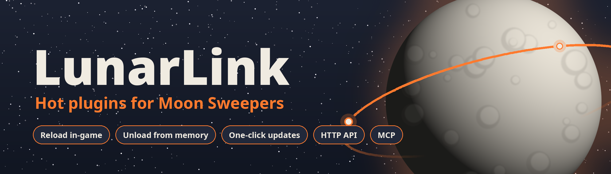
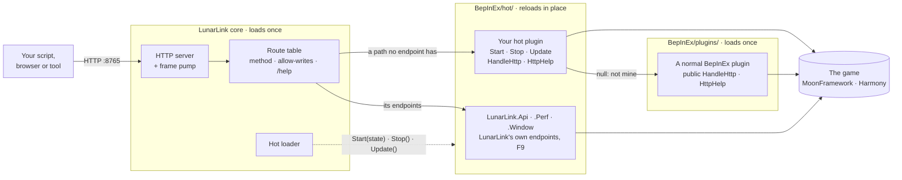
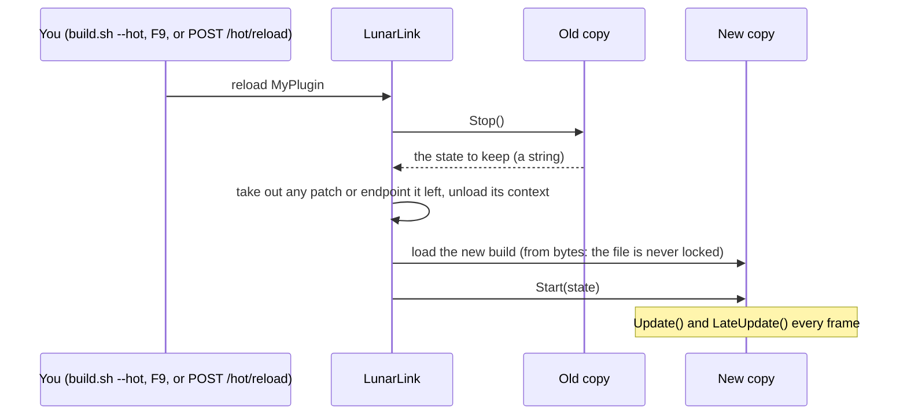

# LunarLink



**A framework for Moon Sweepers plugins that reload while the game runs.** Write a new plugin, or convert one you
have, to a short contract; rebuild it, and the running game switches to the new code within a frame. Its Harmony
patches, endpoints and state carry across, with no restart and no reloading the save. LunarLink is a BepInEx 6 (IL2CPP)
plugin.

- **LunarLink is optional.** A plugin written to the hot contract is still a normal BepInEx plugin: players install it in
  `BepInEx/plugins/` and it runs without LunarLink. Put the same DLL in `BepInEx/hot/` with LunarLink installed and it
  becomes hot: it reloads in place.
- **Off means gone.** Turning a hot plugin off stops it and **unloads it from memory**: its code, patches, endpoints and
  objects are gone, with no restart. BepInEx itself can only skip a plugin at the next start, and its code stays loaded
  until then.
- **LunarLink is built the same way.** Its own features are hot modules: `LunarLink.Api` (the endpoints),
  `LunarLink.Perf` (measuring and fps fixes), `LunarLink.Window` (F9) and `LunarLink.Update` (updates). Reload one, or turn it off and it leaves
  memory too - turn off the API and only the core's `/status` and `/hot/*` still answer.
- **Updates, for LunarLink and your plugins.** F9's UPDATES tab checks (when you ask, or at every game start if you
  tick that) and installs LunarLink's
  releases, its single modules as built from `main`, and any plugin that says where its builds are with
  `UpdateFeed()`: on GitHub or any public HTTPS host. **Only the core needs a restart:** every module and every hot
  plugin updates in place while the game runs.
- **Your regular plugins too.** F9 and `/plugins` list every normal BepInEx plugin with its version and what needs it,
  and turn it on or off for the next start, without moving files by hand.
- **An HTTP gateway** into the game: a JSON API to read the world, build, remove, move the player and the camera,
  host crew games and measure performance. Every one of those endpoints is itself a hot plugin, and any plugin can add
  its own. An [MCP server](mcp/README.md) lets an AI assistant use it.

[Download](https://github.com/swheettaos/lunarlink/releases/latest) · [Nexus Mods](https://www.nexusmods.com/moonsweepers/mods/158) · [Docs site](https://swheettaos.github.io/lunarlink/) · [API reference](https://swheettaos.github.io/lunarlink/api.html) ·
[Wiki](https://github.com/swheettaos/lunarlink/wiki) · [Writing a hot plugin](docs/HOT_PLUGINS.md)

## How it fits together

LunarLink is the hub: a small core that loads once, and plugins that hook into it.



There are three ways to hook in:

1. **A hot plugin** in `BepInEx/hot/`: `Start(state)` and `Stop()`, optionally `Update()`, `HandleHttp`, `HttpHelp`
   and `Boot()`. LunarLink drives it every frame, hands state across reloads and passes it any request no endpoint
   took. It needs no reference to LunarLink.
2. **A normal BepInEx plugin** in `BepInEx/plugins/`: give its plugin class a public `string HandleHttp(string method,
   string path, NameValueCollection query, string body)` (return `null` for "not mine") and `string[] HttpHelp()`.
   Its endpoints answer and show in `/help` and F9; it doesn't reload, but F9 turns it on or off for the next start.
3. **Both at once**: write it as a hot plugin and add a small host class (`samples/HelloHot/HotHost.cs`), so players
   run it as a normal plugin and you reload it hot while you work. Its endpoints answer the same either way.

Every endpoint, LunarLink's own included, goes through the same route table, the same `allow-writes` check and the
same `/help` list.

## Hot plugins

BepInEx loads a plugin once, at game start, for good: every change means quitting, rebuilding, starting the game and
loading the save again. LunarLink loads DLLs from **`BepInEx/hot/`** itself, each copy into its own collectible load
context, so a new build replaces the running one in place:



A reload is usually a few milliseconds; a plugin with hundreds of game hooks takes up to about a tenth of a second.
Old copies are freed: LunarLink clears the caches in Il2CppInterop and Harmony that would otherwise keep every copy
alive (`Bridges.cs`).

### The contract

A hot plugin needs **no reference to LunarLink**. It's a public class with a parameterless constructor, found by its
method names:

| Method | When | Must |
|---|---|---|
| `void Start(string state)` | Loaded, once a moon has loaded | Patch, subscribe, register. `state` is what the previous copy's `Stop()` returned (`null` the first time) |
| `string Stop()` | Before it's unloaded | Undo **everything** `Start` did, and return the state for the next copy |
| `void Update()`, `void LateUpdate()` | Every frame (optional) | A hot plugin has no MonoBehaviour of its own |
| `string HandleHttp(string method, string path, NameValueCollection query, string body)` | A request no endpoint took (optional) | Answer JSON, or `null` for "not mine" |
| `string[] HttpHelp()` | For `/help` (optional) | One `"GET /path \| what it does"` per endpoint |
| `static void Boot()` | Once, at game start (optional) | Register MoonFramework buildings, which it only accepts then |
| `string UpdateFeed()` | When the player checks for updates (optional) | Say where your builds are: `github:you/repo` or any public HTTPS address of an update file; LunarLink offers and installs them ([how](docs/HOT_PLUGINS.md#letting-it-update-itself)) |

```csharp
public class Main
{
    Harmony harmony; int starts;

    public void Start(string state)
    {
        int.TryParse(state, out starts); starts++;
        harmony = new Harmony("HelloHot");
        harmony.PatchAll(typeof(Main).Assembly);      // your patches
    }

    public string Stop()
    {
        harmony.UnpatchSelf();                         // undo everything Start did
        return starts.ToString();                      // handed to the next copy
    }

    public string HandleHttp(string method, string path, NameValueCollection q, string body) =>
        path == "/hello" ? "{\"starts\":" + starts + "}" : null;
}
```

The same DLL still ships as a normal BepInEx plugin: a small host class (`samples/HelloHot/HotHost.cs`) calls `Start`
and `Update` for players who don't run LunarLink. Start from `samples/HelloHot`; the full guide, with the rules and
shipping, is [docs/HOT_PLUGINS.md](docs/HOT_PLUGINS.md), and the wiki has
[examples](https://github.com/swheettaos/lunarlink/wiki/Plugin-Examples) and
[plugins with buildings](https://github.com/swheettaos/lunarlink/wiki/Plugins-with-Buildings).

### The loop

```bash
./build.sh --hot HelloHot     # game running: build it, copy it into BepInEx/hot/, reload it
curl -s 127.0.0.1:8765/hello  # try it; edit, and run the first line again
```

`./build.sh --hot <Name>` takes a module (`src/LunarLink.<Name>`) or a sample (`samples/<Name>`). Your own project
only needs to copy its DLL into `BepInEx/hot/` and call `POST /hot/reload?name=<Name>`, or press **Reload** in F9.

### Managing them

**Disable** stops a hot plugin and unloads it: its load context is dropped and its memory freed (`GET /hot/list?gc=1`
shows old copies still in memory, normally 0). **Enable** loads it fresh from disk. Neither needs a restart.

`BepInEx/hot/hot.json` remembers which plugins are on (`{"enabled": [names], "disabled": [names]}`). A DLL in neither
list stays **off** until you enable it, so nothing runs just because a file appeared.

| Endpoint | What it does |
|---|---|
| `GET /hot/list[?gc=1]` | Each hot plugin: state (`running`, `loaded` before a moon is up, `disabled`, or `failed` with the error), the loaded build's time, whether a newer build is on disk, leftovers, old copies still in memory |
| `POST /hot/reload?name=` | Stop it, load the build on disk now, start it with the old copy's state. Turns it on if it was off |
| `POST /hot/reload?all=1` | Reload every plugin with a newer build on disk |
| `POST /hot/enable?name=` · `/hot/disable?name=` | Turn it on (load and start) or off (stop and unload), and remember it |
| `POST /hot/rescan` | Pick up DLLs added to or removed from the folder |

**In the game, F9** opens LunarLink's window: every hot plugin with its state, build time, a "newer build on disk"
mark and its error, with Enable, Disable and Reload, plus Reload changed and Rescan. Its other tabs turn **normal
BepInEx plugins** on or off for the next start (the DLL is renamed to `.dll.disabled` and back; a plugin another one
needs can't be turned off) and list every endpoint.

### What LunarLink checks for you

- A DLL that doesn't fit (no `Start`/`Stop`, a missing reference) shows as `failed` with the reason and runs nothing.
- A `Start` that throws is unloaded again, its patches and endpoints with it; everything else carries on.
- A Harmony patch still in after `Stop()` is taken out and reported as a leftover, and the copy's endpoints are removed.
- A plugin BepInEx already loaded from `BepInEx/plugins/` is refused, so it can't run twice.

A hot plugin runs with the same rights as any BepInEx plugin: **there is no sandbox**. Only enable DLLs you trust.
How it's built, and why: [docs/HOT_RELOAD_PLAN.md](docs/HOT_RELOAD_PLAN.md).

## The HTTP gateway

LunarLink answers HTTP on **`http://127.0.0.1:8765/`**, with JSON. Its endpoints live in hot modules,
`LunarLink.Api` (world, base, build, player, game, host, dev) and `LunarLink.Perf` (measuring and fps fixes), so they
change without a restart too. Any plugin, hot or normal, can add its own with `HandleHttp`.

```bash
curl -s 127.0.0.1:8765/status                                   # is it up, which build
curl -s "127.0.0.1:8765/structures?x=0&y=2000&z=0&r=30"         # everything within 30 m of a point
curl -s "127.0.0.1:8765/base/health?x=0&y=2000&z=0&r=150"        # is this base working?
curl -s -X POST 127.0.0.1:8765/belts/check -d '{"start":[...],"startDir":[...],"end":[...],"endDir":[...]}'
```

**One pattern.** `GET /thing` lists it; `POST /thing/check` asks the game whether a change would work without making
it; `POST /thing/create`, `/thing/modify` and `/thing/remove` change it. A request with the wrong method gets
`{"error": "use POST for ..."}`, and an unknown path answers with every path there is.

**Every endpoint, searchable:** `http://127.0.0.1:8765/help.html` in a browser while the game runs (plugins'
included), `GET /help` as JSON, the API tab in F9, or the [API reference](https://swheettaos.github.io/lunarlink/api.html)
with the game off.

**For an AI assistant:** [`mcp/`](mcp/) is an MCP server that turns these endpoints, plugins' included, into tools
for Claude Desktop, Claude Code or any MCP client; reads only unless you start it with `--allow-writes`
([how to add it](mcp/README.md), [wiki](https://github.com/swheettaos/lunarlink/wiki/MCP)).

**How a request runs.** A small TCP server (one request per connection; `HttpListener` stalls under Proton) queues it;
LunarLink's frame pump answers queued requests on Unity's main thread, where game calls are safe, for up to about
8 ms a frame. A very big request is a short hitch, so filter it. Nothing is answered until the game's loading screen
is gone, and until a moon is loaded only `/status` and `/hot/*` answer.

**Writes are off by default.** Anything that builds, removes, teleports or changes a setting needs the file
`BepInEx/plugins/LunarLink/allow-writes` (`touch` it; delete it to make LunarLink read-only again). Without it those
requests answer `{"error":"writes disabled (no allow-writes file)"}`. A POST passed on to a plugin needs it too.

**This machine only, unless you say otherwise.** In `BepInEx/config/lunarlink.cfg`, `[Server]`:

| Setting | Default | What it does |
|---|---|---|
| `Address` | `127.0.0.1` | This machine's address on your network (for example `192.168.1.20`), or `0.0.0.0` for every network, lets other machines in. An address that isn't this machine's falls back to `127.0.0.1` (the log says so) |
| `Port` | `8765` | The port |
| `Access key` | empty | What another machine must send: the header `X-LunarLink-Key: <key>`, or `?key=<key>` (never written to the request log). Empty: other machines are refused. Requests from this machine never need it |

The API can build, remove, kick and ban, so pick a long random key and only open it on a network you trust. Changes to
`[Server]` apply at the next game start.

**After a freeze, look at `BepInEx/plugins/LunarLink/requests.log` first.** Every request is written as it starts and
finishes, and a watcher thread writes **`MAIN THREAD STUCK`** with the last 400 steps if no frame finishes for 3 s.

## Install

**From a release:** download `LunarLink-<version>.zip` from [Nexus Mods](https://www.nexusmods.com/moonsweepers/mods/158) or the [latest release](https://github.com/swheettaos/lunarlink/releases/latest), close the game and unzip it
into the game's folder (the one that holds `BepInEx/`). Needs only BepInEx 6 (IL2CPP); MoonFramework is optional: LunarLink uses it only for Perf's power fix and for plugins that add buildings.

**Updating from the game:** F9's UPDATES tab has **Check for updates**, which asks GitHub for the latest release and
the module channel (only when you press it, unless you tick **Check for updates at game start**): a newer release gets
an **Update** button, and so does each module with a
newer build from `main`. The download is checked against the SHA-256 GitHub publishes.
If only the modules changed, they reload in place with no restart; if the core changed, the new core is put in place and
the window says to restart the game to finish. The same over HTTP: `POST /update/check`, `GET /update`,
`POST /update/apply`. Or unzip a new release over the old files with the game closed.

**Your other plugins:** hot-compatible ones (their docs say they reload in place, like Crew Tools) go in
`BepInEx/hot/` and turn on in F9; every other plugin stays in `BepInEx/plugins/` as usual. Never both.
[Installing Plugins](https://github.com/swheettaos/lunarlink/wiki/Installing-Plugins) has the details.

**From source:** needs the .NET 8 SDK in `~/.dotnet`, and the game with BepInEx 6 (IL2CPP) installed (not MoonFramework). The project
references the game's DLLs from `~/.local/share/Steam/steamapps/common/Moon Sweepers` (set `MOON_GAME_DIR` to change
it). Settings shared by every project are in `Directory.Build.props`. The [wiki](https://github.com/swheettaos/lunarlink/wiki) is built
from `wiki/` by `tools/wiki.py` on every push.

```bash
./build.sh                  # build the core and every module
./build.sh --install        # game closed: the core into plugins/LunarLink/, the modules into hot/, new modules on
./build.sh --hot Api        # game running: rebuild one module (or a sample) and reload it in the game
```

| Part | Where | Reloads |
|---|---|---|
| The core, `src/LunarLink`: server, frame pump, route table, hot loader | `BepInEx/plugins/LunarLink/LunarLink.dll` | No: game start only |
| `src/LunarLink.Api`, `src/LunarLink.Perf`, `src/LunarLink.Window` (the F9 window), `src/LunarLink.Update` (updates) | `BepInEx/hot/` | Yes |

**Releasing.** Put the version in `src/LunarLink/Server.cs`'s `[BepInPlugin]`, add its section to `CHANGELOG.md`, commit
and push, then `tools/release.sh <x.y.z>`: it builds, zips the files in the game's folder layout and publishes the
GitHub release with that changelog section. It runs here rather than on GitHub because the build needs the game's own
DLLs. `--dry-run` only builds the zip into `dist/`.

**Version.** `/status` reports the running build's stamp; `./build.sh --install` writes the same stamp to
`BepInEx/plugins/LunarLink/installed-version`. If they differ, the game is still running an older core: restart it.

## Something wrong?

Open **`http://127.0.0.1:8765/support`** in a browser while the game runs (or press F9 → **Support file**). It saves
`BepInEx/lunarlink-support-<date-time>.zip` with what's needed to find the problem: what failed, the errors from the
logs of this run and the previous one, your plugins and settings, with names, Steam ids and addresses blanked out.
Attach it to a [bug report](https://github.com/swheettaos/lunarlink/issues/new/choose).

## Endpoints

LunarLink's own endpoints, by area. The tables and the [API reference](https://swheettaos.github.io/lunarlink/api.html)
are made from the code and `docs/endpoints.toml` (each endpoint's parameters, an example and a real answer) by
`tools/endpoints.py`. A module's endpoints come and go with it.

<!-- endpoints:start (tools/endpoints.py) -->
### LunarLink (core)

The core: status and hot plugins.

| Endpoint | What it does |
|---|---|
| `GET /status` | Is LunarLink up: its build, whether a world is loaded, game time, queue and frames |
| `GET /support` | Write a support file (BepInEx/lunarlink-support-<time>.zip) to attach to a GitHub issue: what failed, logs, plugins, settings, names blanked out |
| `GET /hot/list` | ?gc=1 : the hot plugins: state, build, newer build on disk, errors, leftovers, old copies still in memory |
| `POST /hot/reload` | ?name= : reload a hot plugin from the build on disk now (and turn it on); ?all=1 : every one with a newer build |
| `POST /hot/enable` | ?name= : load and start a hot plugin, and remember it's on |
| `POST /hot/disable` | ?name= : stop and unload a hot plugin, and remember it's off |
| `POST /hot/rescan` | Pick up DLLs added to or removed from BepInEx/hot/ |

### World (LunarLink.Api)

What's in the world, read only: structures, belts, stations, terrain, capsules, kinds, the conveyor kit, recipes, the sun, the moon's cleaned share and where dust is left.

| Endpoint | What it does |
|---|---|
| `GET /structures` | Every structure: id, kind, pos, rotation, support. ?x=&y=&z=&r= within r m of a point; ?kind=1,2; ?since=<id> only newer |
| `GET /belts` | Every belt piece: id, start/end points and directions, length |
| `GET /stations` | The stations: index, name, pos, intake sockets |
| `GET /stations/shape` | ?index= : every collider of a station as the 8 corners of its box |
| `GET /stations/footprint` | ?index=&step= : where a station's building really is (rays down onto its colliders) |
| `GET /terrain` | ?x=&y=&z=&half=&step= : ground heights on a grid round a point |
| `GET /canisters` | ?x=&y=&z=&radius= : capsules near a point: cargo, kg, riding, carried; and the totals |
| `GET /kinds` | Structure kinds standing in the world; ?all=1 every kind the game defines: name, prefab, price, footprint, height, ports |
| `GET /kit` | The conveyor kit's limits: length, radius, slope, height, price per metre |
| `GET /specs` | Machine recipes: batch sizes, cycle times, slots, belt speed |
| `GET /sun` | The sun: direction, height, lunar day length, clock |
| `GET /moon` | The cleaned share of the moon, as the map screen shows it |
| `GET /dust/regions` | Every region not complete: index, centre, dust left, dust it started with |
| `GET /dust/geometry` | Region centres and chunk-file centres, written to dust_geometry.json for offline save editing |

### Base (LunarLink.Api)

Is a base working: production machines, capsule catchers, the solar grids and the robots.

| Endpoint | What it does |
|---|---|
| `GET /production` | Every production machine: cycles, progress, power, status, stored dust/sand/stone per slot |
| `GET /catchers` | Every capsule catcher: kg stored, full, and whether its outlet works |
| `GET /power` | The solar grids: supply, demand, use, satisfaction, battery charge; and the panel types |
| `GET /base/health` | ?x=&y=&z=&r=100 : is a base working - machines the game says are stuck (and why), catchers with a dead outlet, robots docked here not cleaning, and power grids short anywhere; idle machines are only counted |
| `GET /robots` | Every J.O.O.N.A.S.: the game's robot map (dock, state, kg carried) with the region under it |

### Build (LunarLink.Api)

Changing the world: structures and belts (check, create, remove), loose capsules, and the player's own build tool.

| Endpoint | What it does |
|---|---|
| `POST /structures/check` | Body {kind, pos:[x,y,z], q:[x,y,z,w], support, raised, free, snapped}: the game's own placement check; builds nothing (changes nothing) |
| `POST /structures/create` | Same body: build it with the game's TryBuildStructure (the player within about 22 m). Returns its id |
| `POST /structures/remove` | ?ids=1,2,3[&refund=0][&robot=1] : out of the world from anywhere, refund paid unless refund=0; robots only with robot=1. One at a time with a gap |
| `POST /belts/check` | Body {start, startDir, end, endDir, startStructure, endStructure, startBelt, endBelt}: can this belt be built, its length and price (changes nothing) |
| `POST /belts/create` | Same body: build the belt (the player within about 22 m). Returns its id |
| `POST /belts/remove` | ?ids=1,2,3 : belts out with the game's undo, from anywhere, refunded |
| `POST /canisters/remove` | ?id= : delete one loose capsule (not riding, carried or flying) |
| `GET /builder` | The player's build tool: placing, ghost kind, valid, reason, plan, what overlaps the preview |
| `POST /builder/aim` | Body {kind, from:[x,y,z], to:[x,y,z], wheel, free}: pick a kind and aim the real build tool |
| `POST /builder/place` | Press place on the aimed build tool |
| `POST /builder/stop` | Put the build tool down |

### Player (LunarLink.Api)

The player and the screen: where the player is and moving them, the observer camera, a line of text on screen, and the game's own cleaning at a point.

| Endpoint | What it does |
|---|---|
| `GET /player` | The local player: pos, forward, pitch, heading, camera forward |
| `POST /player/modify` | ?x=&y=&z= : move the player there with the game's teleport (ignored while they're in a vehicle) |
| `GET /camera` | Which camera draws: the game's or the observer camera, and where it is |
| `POST /camera/modify` | ?x=&y=&z=&tx=&ty=&tz=[&fov=][&hide=1] : the observer camera there, looking at t; hide=1 stops the game's camera drawing |
| `POST /camera/remove` | Remove the observer camera and give the game's camera back |
| `POST /message` | ?text=[&ttl=15][&y=0.5][&size=20] : a line of text on screen; empty text hides it |
| `POST /clean` | ?x=&y=&z=&r=&a= : the game's own CleanAt round a point |

### Game (LunarLink.Api)

The session itself: the team's money and the process's threads.

| Endpoint | What it does |
|---|---|
| `GET /game/money` | The team's money |
| `GET /debug/threads` | Every thread of the game's process: id, state, CPU seconds, when it started (for a hang) |

### Host (LunarLink.Api)

Crew games: what the hosted game publishes to Steam, its name, and the players' vehicles.

| Endpoint | What it does |
|---|---|
| `GET /lobby` | What the hosted game publishes to Steam: the crew name and every lobby key |
| `POST /lobby/modify` | ?name= sets the hosted game's name; or ?key=&value= sets one lobby key. Host only |
| `GET /vehicles` | Every owned vehicle: storage id, owner, garage, type, in the world or stored, price |
| `POST /vehicles/remove` | ?storage=[&refund=1] : take one owned vehicle away; refund=1 pays its garage price to the team |

### Dev (LunarLink.Api)

Reading the game's code from inside the running game: find methods, cross-references, disassembly, fields; and calling a parameterless game method on purpose.

| Endpoint | What it does |
|---|---|
| `GET /dev/find` | ?name= : every game method by that name: class, static, parameters, returns, live objects |
| `GET /dev/xref` | ?find=text[&type=MoonCleaners.X] : game methods whose code uses a string containing text |
| `GET /dev/dis` | ?type=MoonCleaners.X&method=Name[&n=0][&bytes=8192] : disassembly with its strings and called methods named |
| `GET /dev/fields` | ?type=MoonCleaners.X : a class's fields with their memory offsets |
| `GET /dev/name` | ?addr=hex : which known method contains a code address |
| `POST /dev/call` | ?type=&method= : call a parameterless game method (static, or on every live object of the class) |

### Help (LunarLink.Api)

Every endpoint and what it does: the core's, each module area's and each plugin's, as JSON and as a searchable page.

| Endpoint | What it does |
|---|---|
| `GET /help` | ?path= : every endpoint and what it does (this list); &details=1 adds LunarLink's own endpoints' parameters, examples and answers |
| `GET /help.html` | The same list as a searchable page, with the details: open it in a browser |

### BepPlugins (LunarLink.Window)

The normal BepInEx plugins: listed, and turned on or off for the next game start.

| Endpoint | What it does |
|---|---|
| `GET /plugins` | The normal BepInEx plugins: name, guid, version, file, state, what needs them |
| `POST /plugins/disable` | ?file= : off from the next game start (restart required) |
| `POST /plugins/enable` | ?file= : on from the next game start (restart required) |

### Perf (LunarLink.Perf)

Measuring and fps fixes. Every Harmony patch this module makes is under an id starting with "LunarLink.Perf.", and Stop() takes them all out, so turning the module off (or reloading it) removes every timer and fix it put in. fixes: PowerFix (a faster PowerSystem.Link, and refused capsule offers backed off), AudioFix (machine sound loops off beyond a distance). Their settings are files in BepInEx/plugins/LunarLink/.

| Endpoint | What it does |
|---|---|
| `GET /perf` | fps and ms per frame of the timed systems since the last read (read once, wait, read again); with the engine counters on, Unity's own (engineMs) |
| `POST /perf/engine` | ?on=1\|0 : Unity's own frame counters (frame, scripts, physics, rendering, GPU wait, draw calls) on or off |
| `POST /perf/timers` | Stopwatches on the game's and MoonFramework's main systems, read through /perf. They cost frame time: reload or disable the module to take them out |
| `POST /perf/time` | ?type=Full.Name&method=Name/paramCount : a stopwatch on one method, read through /perf |
| `GET /perf/methods` | ?type=X : the methods a class declares, to pick what to time |
| `GET /census` | ?top= : every component class counted, with which have per-frame methods |
| `GET /perf/fixes` | The fps fixes: power (fast link on, offer back-off frames) and audio (silent beyond m metres), with their counters |
| `POST /perf/fixes/modify` | ?name=power&on=1\|0 / ?name=power&backoff=N / ?name=audio&m=N (0 = off) : change a fix and keep the setting |

### Update (LunarLink.Update)

Updating LunarLink from GitHub's releases and the module channel, when asked (or at game start if chosen): check, see each module's state, install a release (a new core needs a restart) or single modules (reloaded in place).

| Endpoint | What it does |
|---|---|
| `GET /update` | What LunarLink's updater knows: the running version, the latest release, each module in the module channel, each plugin with an UpdateFeed(), and how far an update got |
| `POST /update/modify` | ?auto=1\|0 : check for updates by itself once a moon is loaded, at every game start (off by default: checking is manual) |
| `POST /update/check` | Ask GitHub for LunarLink's latest release and the module channel, and each plugin's update feed, then read GET /update (changes nothing) |
| `POST /update/apply` | Install the latest release (modules reload in place; a new core needs a restart), or ?module=<name>\|all: modules from the channel, reloaded in place, or ?plugin=<name>: a plugin's own update (UpdateFeed). ?force=1 reinstalls the same release |
<!-- endpoints:end -->

**Removing**, one structure at a time with a gap of about 0.25 s: a structure removal costs the game about 15 ms if the
last one was 0.25 s earlier, but 100-130 ms straight after another, so removing many in one go freezes the game.

**The fixes** (the Perf module) keep their settings in small files in `plugins/LunarLink/` (`power_fix.txt`,
`offer_backoff.txt`, `audio_far.txt`) and go in when the module starts, each only when its setting asks for it.

**Reading the game's code** (the Dev area) is crash-safe: every read is a `ReadProcessMemory` on the game's own
process; nothing in the game is initialised or called (except `POST /dev/call`). How a question is answered: `xref` finds where a message is used; `dis` that method; follow its calls with `dis` again.
(This is how "Save unavailable. Building is paused." was traced to `Task.IsFaulted` on the player's own save task.)

---

## License

GPL-3.0 (see [LICENSE](LICENSE)). The documentation is also at https://swheettaos.github.io/lunarlink/ (the API reference and the plugin guide).
