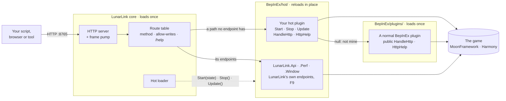

# LunarLink

LunarLink is a framework for **Moon Sweepers** plugins that reload while the game runs (BepInEx 6, IL2CPP).

- **Hot reloading.** Write a new plugin, or [convert one you have](Writing-a-Hot-Plugin#converting-an-existing-plugin),
  to a short contract. Put it in `BepInEx/hot/`, rebuild it, and the game uses the new code within a frame - no
  restart, no reloading the save. Its patches, endpoints and state carry across.
- **LunarLink is optional.** A plugin written to the hot contract is still a normal BepInEx plugin: players install it in
  `BepInEx/plugins/` and it runs without LunarLink. Put the same DLL in `BepInEx/hot/` with LunarLink installed and it
  becomes hot: it reloads in place.
- **Off means gone.** Turning a hot plugin off stops it and **unloads it from memory**: its code, patches, endpoints and
  objects are gone, with no restart. BepInEx itself can only skip a plugin at the next start, and its code stays loaded
  until then.
- **LunarLink is built the same way.** Its own features are hot modules: `LunarLink.Api` (the endpoints),
  `LunarLink.Perf` (measuring and fps fixes), `LunarLink.Window` (F9) and `LunarLink.Update` (updates). Reload one, or turn it off and it leaves
  memory too - turn off the API and only the core's `/status` and `/hot/*` still answer.
- **Updates, for LunarLink and your plugins.** F9's UPDATES tab checks (when you ask, or at every game start if you
  tick that) and installs LunarLink's
  releases, its single modules as built from `main`, and any plugin that says where its builds are with
  `UpdateFeed()`: on GitHub or any public HTTPS host. **Only the core needs a restart:** every module and every hot
  plugin updates in place while the game runs.
- **Your regular plugins too.** F9 and `/plugins` list every normal BepInEx plugin with its version and what needs it,
  and turn it on or off for the next start, without moving files by hand.
- **An HTTP gateway into the running game**, built from hot plugins itself. Read the world (structures, belts, terrain,
  capsules, production, power, robots), change it (build, remove, move the player and the camera), check whether a base
  is working, host crew games, measure performance and read the game's own code - from a script, a browser or another
  tool. Any plugin, hot or normal, can add its own endpoints.

An in-game window (**F9**) shows the hot plugins, turns normal BepInEx plugins on or off, and lists every endpoint.

## How it fits together

There are three ways to hook in:

1. **A hot plugin** in `BepInEx/hot/`: `Start(state)` and `Stop()`, optionally `Update()`, `HandleHttp`, `HttpHelp`
   and `Boot()`. LunarLink drives it every frame, hands state across reloads and passes it any request no endpoint
   took. It needs no reference to LunarLink.
2. **A normal BepInEx plugin** in `BepInEx/plugins/`: give its plugin class a public `string HandleHttp(string method,
   string path, NameValueCollection query, string body)` (return `null` for "not mine") and `string[] HttpHelp()`.
   Its endpoints answer and show in `/help` and F9; it doesn't reload, but F9 turns it on or off for the next start.
3. **Both at once**: write it as a hot plugin and add a small host class ([[Plugin Examples]]), so players
   run it as a normal plugin and you reload it hot while you work. Its endpoints answer the same either way.

Every endpoint, LunarLink's own included, goes through the same route table, the same `allow-writes` check and the
same `/help` list.

## Your first five minutes

1. **Install it** with the game closed: `./build.sh --install` ([[Installing]]).
2. **Start the game and load a moon.** LunarLink waits until the loading screen is gone.
3. **Ask it something:** `curl -s 127.0.0.1:8765/status` answers with the build and what's loaded.
4. **Open `http://127.0.0.1:8765/help.html`** in a browser: every endpoint there is right now, searchable.
5. **Press F9** in the game: the hot plugins, your normal BepInEx plugins and the same endpoint list.
6. **Want to build or remove things?** Create the `allow-writes` file ([[Settings]]), then try
   `POST /structures/check` before `POST /structures/create`.

## Start here

| If you want to | Read |
|---|---|
| Reload plugins without restarting | [[Hot Plugins]] |
| Make a plugin you have hot | [[Writing a Hot Plugin]] (Converting an existing plugin) |
| Write your own hot plugin | [[Writing a Hot Plugin]], with code in [[Plugin Examples]] |
| Install it | [[Installing]] |
| Install other plugins: which go in `BepInEx/hot/`, which in `BepInEx/plugins/` | [[Installing Plugins]] |
| Change the port, open it to another machine, allow changes | [[Settings]] |
| Call the API from a script or a browser | [[Using the API]] |
| Do a whole job (film a base, build by script, find what's wrong) | [[API Recipes]] |
| Let an AI assistant (Claude, Cursor...) use the game | [[MCP]] |
| Look up an endpoint | [[API Reference]] (or the searchable page on the [docs site](https://swheettaos.github.io/lunarlink/api.html)) |
| Use the in-game window | [[The F9 Window]] |
| Update LunarLink, or let your plugin update itself | [[Updates]] |
| Find out why the frame rate dropped | [[Performance Tools]] |
| Fix something that went wrong | [[Troubleshooting]] |
| Understand how it's built | [[How It Works]] |
| Report a bug or send a change | [[Contributing]] |

## At a glance

- Listens on `http://127.0.0.1:8765/` - this machine only, unless you choose an address and an access key.
- Reads are `GET`; anything that changes the game is `POST` and needs an `allow-writes` file, so nothing changes the
  game by accident.
- `GET /help` (or `/help.html` in a browser) lists every endpoint there is right now, plugins' included.
- Download it from [Nexus Mods](https://www.nexusmods.com/moonsweepers/mods/158) or the [latest release](https://github.com/swheettaos/lunarlink/releases/latest).
- Licensed under the [GPL-3.0](https://github.com/swheettaos/lunarlink/blob/main/LICENSE).
