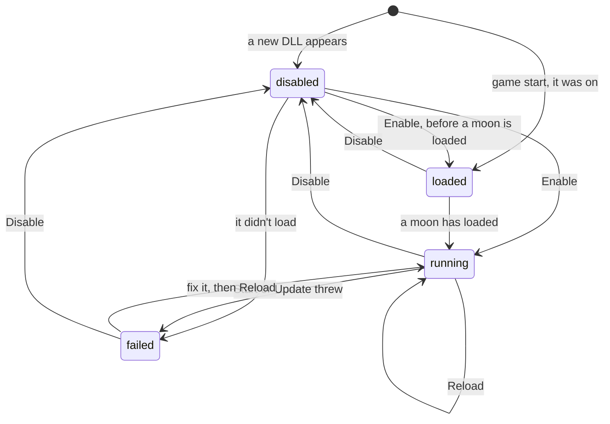
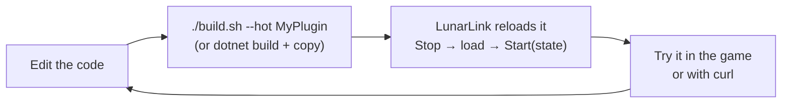
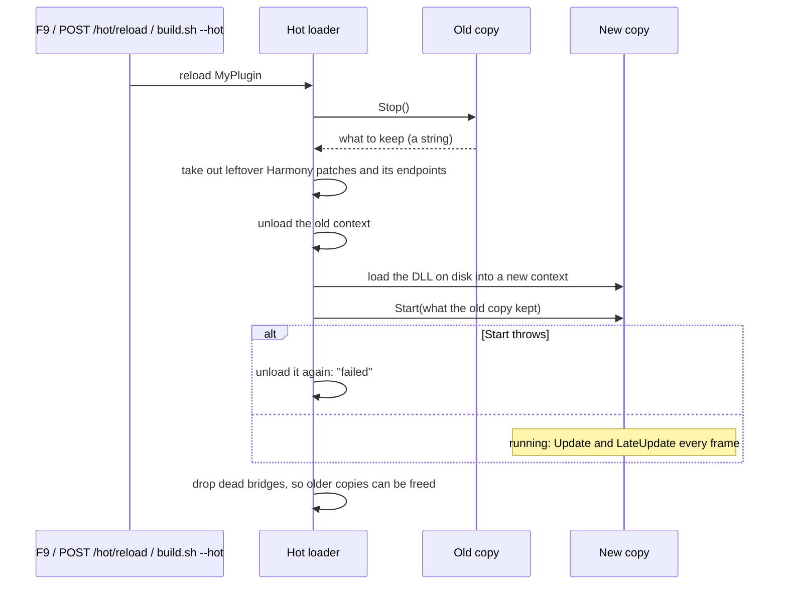

# Hot Plugins

A hot plugin is a DLL that LunarLink loads from **`BepInEx/hot/`** and can reload while the game runs. LunarLink's own
endpoints, its fps fixes and the F9 window are hot plugins themselves (`LunarLink.Api`, `LunarLink.Perf`,
`LunarLink.Window`), and any plugin written to a few rules can be one (see [[Writing a Hot Plugin]]).

LunarLink is optional for the people who use your plugin: a hot plugin is still a normal BepInEx plugin, and runs
without LunarLink from `BepInEx/plugins/`. It's hot only when it's in `BepInEx/hot/` with LunarLink installed.

**Normal BepInEx plugins can go in `BepInEx/hot/` too (experimental).** A plugin that wasn't written to these rules
runs *wrapped* (see [[The Wrapper]]): it loads like BepInEx would load it, and
Reload and Disable work on it too.

**A plugin can have its own folder:** `BepInEx/hot/<Name>/<Name>.dll`, a folder named like its DLL. Files the plugin
reads beside its DLL go in that folder, and so do DLLs it needs, which load with it.

## Why a separate folder

(Which of your plugins go where, and how to move one: [[Installing Plugins]].)

BepInEx loads every DLL under `BepInEx/plugins/` at game start, once, for good. A hot DLL there would run twice (once
from BepInEx, once from LunarLink) and could never be reloaded. So hot plugins live in `BepInEx/hot/`, and the same DLL
goes in `BepInEx/plugins/` only when it's shipped to people who run it the normal way. LunarLink refuses a hot copy of a
plugin BepInEx already loaded, so it can't run twice by mistake.

## On and off

`BepInEx/hot/hot.json` remembers which hot plugins are on (`enabled`) and which you turned off (`disabled`). A DLL new
to the folder stays **off** until you turn it on, so nothing runs just because a file appeared.

| State | Means |
|---|---|
| `running` | Loaded and started |
| `loaded` | Loaded, waiting for a moon to load before it starts |
| `disabled` | Off: not loaded, now or at the next start. Turning a running plugin off **unloads it from memory**: its code, patches and endpoints are gone, no restart needed |
| `failed` | It didn't load or start; the error says why. Nothing of it runs |

## Reloading

From the game: [[The F9 Window]] (**Reload** on a row, **Reload changed** for everything with a newer build on disk).
From a script:

| Request | Does |
|---|---|
| `GET /hot/list[?gc=1]` | Every hot plugin: state, the loaded build's time, newer build on disk, error, leftovers, old copies still in memory |
| `POST /hot/reload?name=` | Stop it, load the build on disk now, start it with what the old copy handed over (and turn it on) |
| `POST /hot/reload?all=1` | Reload every plugin that has a newer build on disk |
| `POST /hot/enable?name=` · `/hot/disable?name=` | Turn it on (load and start) or off (stop and unload), and remember it |
| `POST /hot/rescan` | Pick up DLLs added to or removed from the folder |

The usual loop while writing one:

From the repo, with the game running: `./build.sh --hot <Name>` builds a module or a sample, copies it in and reloads it.

## What a reload does

1. The old copy's `Stop()` runs: it undoes what it did and hands over what the next copy should keep.
2. LunarLink checks for anything left behind: a Harmony patch still in is taken out and reported as a leftover; the
   copy's endpoints are removed.
3. The new copy loads (into its own load context, from memory, so the file isn't locked) and its `Start(state)` runs.
4. If `Start` throws, the plugin is unloaded again and shows as failed; everything else carries on.

A reload is usually a few milliseconds; a plugin with many game hooks takes longer (tens to a hundred ms), one short
hitch.

## Normal plugins: the wrapper (experimental)

The full story, step by step: [[The Wrapper]].

A plugin with a normal BepInEx plugin class (a `BasePlugin` with `[BepInPlugin]`) and no `Start`/`Stop` of its own
runs wrapped, while the **LunarLink.Wrap** module is on (it is by default). The module rewrites the DLL as it loads it
so that what the plugin starts can be undone, and gives LunarLink an object to start and stop like any hot plugin.

| | What happens |
|---|---|
| **On** | The plugin is created and its `Load()` runs where BepInEx would run it: at game start, once BepInEx has loaded its own plugins (or at once, if you turn it on while the game runs) |
| **Off** | Its own `Unload()` if it has one, then everything it started: its threads are stopped, its timers and native hooks (BepInEx's `INativeDetour`, MonoMod detours) undone, the event handlers it added elsewhere removed, its Unity components destroyed, and its Harmony patches taken out |
| **Reload** | Off, then on with the new build. Il2Cpp keeps a registered type's name for good, so the plugin's own Unity types are registered under a new name in each later copy (`Driver_hot2`) |
| **Its folder** | A wrapped plugin that asks for its own location (`Assembly.Location`) is told its DLL's path, so files beside it are found |

F9 marks a wrapped plugin **wrapped**, and its **?** lists what the wrapper found: what it tracks, and anything it
can't undo. Two things it can't:

- **Native hooks made some other way** (its own calls into hooking libraries): turning it off or reloading it then
  waits for a restart, since the hooks would jump into freed code. F9 shows **off at restart**.
- **Long-running tasks** may keep running after it's off.

What it changed in the game's own state (settings, data it laid out its own way) stays as it is: the wrapper undoes
what the plugin *started*, not what it *did*. Test a plugin's off and on once before relying on it.

**Libraries can't be wrapped. MoonFramework must stay in `BepInEx/plugins/`**: other plugins are built on it, and it
runs the modded buildings in your world (see [[Installing Plugins]]). The wrapper refuses MoonFramework, and any DLL
another installed plugin is built on, with a message in F9. Plugins that *use* MoonFramework can be hot; it stays loaded
underneath them.

Without the module, a normal plugin in `BepInEx/hot/` fails to load with a message saying so. Turning the module off
doesn't stop plugins it already wrapped; they keep running until they're reloaded or turned off.

## Memory

Each copy is loaded so it can be freed. Two caches inside BepInEx's Harmony support would keep every old copy alive
(one bridge per patch change, and a delegate-type cache keyed by it), so after each reload LunarLink drops the entries
of patches that are gone - only ones already dead at the previous reload, so nothing the game could still be calling.
For a wrapped plugin's Unity types, it also frees the bridges Il2CppInterop pins for them, once Unity has removed their
objects. `GET /hot/list?gc=1` shows how many old copies are still in memory.

Known exception: a plugin that Harmony-patches **another mod's** .NET code (not the game's), such as MoonFramework's,
keeps each old copy in memory after a reload (MonoMod holds on to the old patch code). It still reloads and turns off
correctly; it only costs that copy's memory until the game restarts.

## Updating them

A hot plugin that says where its builds are (`public string UpdateFeed()`: `github:owner/repo` or any public HTTPS
address of an update file) gets a row on F9's UPDATES tab: **Update** downloads the new build, checks its SHA-256,
puts it in `BepInEx/hot/` and reloads it, with no restart. See [[Updates]].

## Safety

A hot plugin runs with the same rights as any BepInEx plugin: there is no sandbox. Only turn on DLLs you trust.
