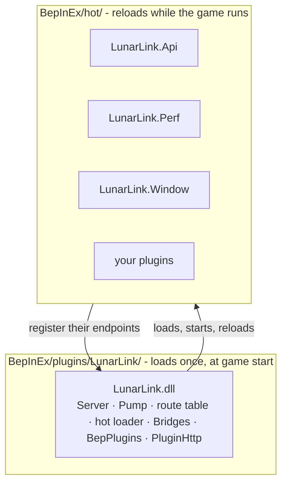
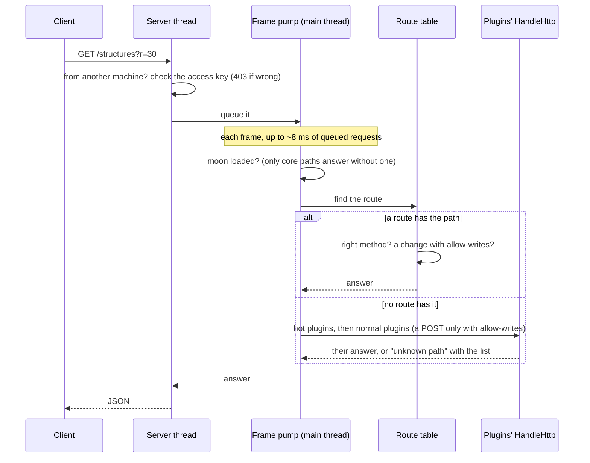
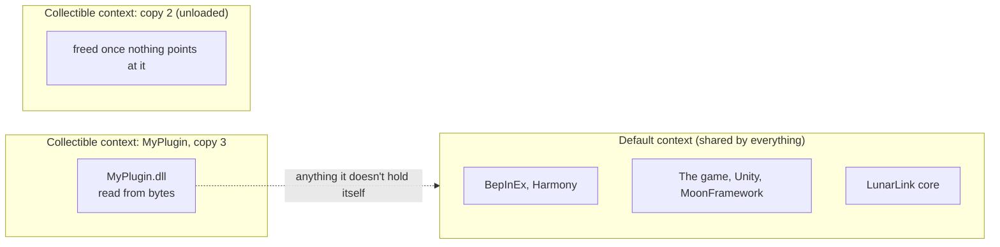

# How It Works

## Core and modules

LunarLink is a small **core** plus **hot modules**:

| Part | File | Reloads? | Holds |
|---|---|---|---|
| Core | `BepInEx/plugins/LunarLink/LunarLink.dll` | No (game start only) | The HTTP server, the frame pump, the request journal and stuck-frame watcher, the route table, the hot loader, `/status`, `/hot/*`|
| `LunarLink.Api` | `BepInEx/hot/` | Yes | Every endpoint area: World, Base, Build, Player, Game, Host, Dev, Help |
| `LunarLink.Perf` | `BepInEx/hot/` | Yes | Measuring and the fps fixes (it patches the game, so it stands alone) |
| `LunarLink.Window` | `BepInEx/hot/` | Yes | The F9 window, and the normal BepInEx plugins on or off (`/plugins/*`) |
| `LunarLink.Update` | `BepInEx/hot/` | Yes | Updates: checking GitHub, installing releases and module builds (`/update/*`). The core keeps only the step that finishes a core update at game start |

The core only holds what must keep working when something else breaks: the server, the freeze log, and the loader that
reloads everything else. Everything that can live in a module does, so changes rarely need a core update (and the
restart one needs). Everything that tends to change lives in a module.

## A request's way through

1. A background thread accepts the connection and reads the request (one per connection; .NET's `HttpListener` stalls
   under Proton, so it's a small `TcpListener` server). Another machine without the access key is refused here.
2. The request waits in a queue for the **frame pump**, LunarLink's one MonoBehaviour. Each frame it answers queued
   requests for up to about 8 ms on Unity's main thread, where game calls are safe.
3. The **route table** finds the endpoint by path. Every endpoint - the core's and each module's - is registered there
   with its method, whether it changes anything, and a one-line description, so the GET/POST and `allow-writes` checks
   happen in one place and `/help` lists them all.
4. A path no route has goes to the hot plugins' `HandleHttp`, then the normal plugins' (a POST only with
   `allow-writes`).
5. The answer goes back on a background thread.

Every request is written to `requests.log` as it starts and finishes, and a watcher thread dumps the last 400 steps if
no frame finishes for 3 seconds.

## Loading a hot plugin

- Each copy is read from bytes (so the file isn't locked) into its own **collectible load context**. Anything the
  context doesn't hold - BepInEx, Harmony, the game, Unity, MoonFramework - comes from the shared default context, so a
  hot plugin works on the same game objects as everything else.
- The plugin is found by method names (`Start`, `Stop`, `Update`, `LateUpdate`, `HandleHttp`, `HttpHelp`, `Boot`), so it
  needs no reference to LunarLink.

- On unload, LunarLink removes the copy's routes and any Harmony patch it left, then unloads the context.

## Freeing old copies

An unloaded copy can only be freed once nothing points at it. Two caches in BepInEx's Harmony support always would:
Il2CppInterop keeps every native-to-managed **bridge** it ever made for a patch change, and Harmony keys a delegate-type
cache by each bridge's method. After every reload LunarLink finds the live bridge of each patched method (by its native
address), and drops the entries of bridges that were already dead at the previous reload - so nothing the game could
still be inside is freed. With that, old copies are freed: after 200 reloads of a test plugin, one copy (the newest
one, waiting its turn) was still in memory.

## Normal plugins on and off

BepInEx loads every `*.dll` under `BepInEx/plugins/` at start. Turning one off renames it to `.dll.disabled`; a loaded
plugin can't be unloaded, so the change applies at the next start. Dependencies come from each plugin's
`BepInDependency` attributes: a plugin another one needs can't be turned off.
