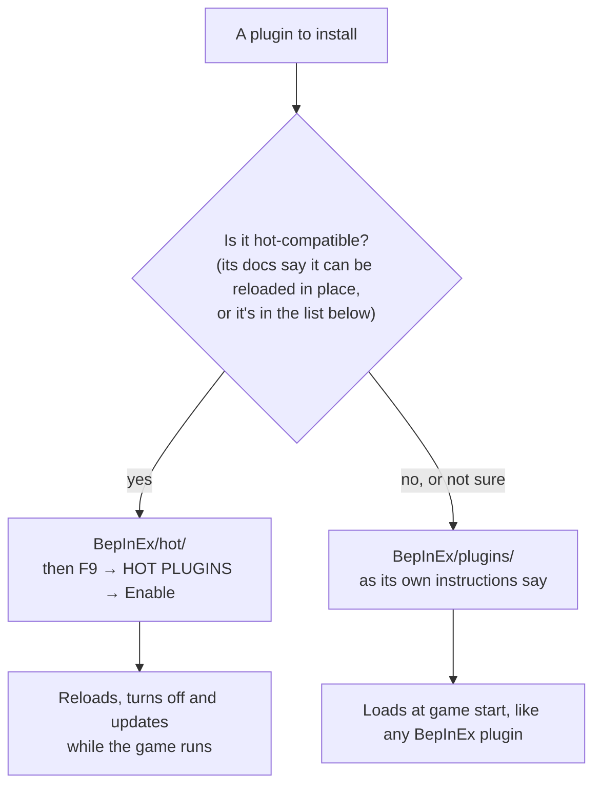

# Installing Plugins

With LunarLink installed, the game has **two plugin folders**. Which one a plugin goes in depends on whether it's
built to reload while the game runs.

| Folder | What goes there | Loaded by | Reloads and updates without a restart? |
|---|---|---|---|
| **`BepInEx/hot/`** | **Hot-compatible plugins**: ones built to start and stop in place (see below) | LunarLink, once a moon has loaded | **Yes**: reload, turn off (it leaves memory), update from F9 |
| **`BepInEx/plugins/`** | **Every other plugin**, exactly as without LunarLink | BepInEx, once, at game start | No: a change needs a restart |

Nothing changes for normal plugins: they still go in `BepInEx/plugins/` as their own instructions say. Only plugins
that support it go in `BepInEx/hot/`.

## Is a plugin hot-compatible?

A hot-compatible plugin has a class LunarLink can start and stop: `Start(string state)` and `Stop()` (see
[[Writing a Hot Plugin]]). You don't need to read its code:

- **Its README or mod page says so**, for example "can be reloaded in place while the game runs", or "works hot with
  LunarLink".
- **Known hot-compatible plugins:**
  - LunarLink's own modules (`LunarLink.Api`, `.Perf`, `.Window`, `.Update`): its installer puts them in
    `BepInEx/hot/` for you;
  - [Crew Tools](https://github.com/swheettaos/crewtools);
  - Quantum Conveyors 2.1 and later.
- **Not sure? Try it.** Put it in `BepInEx/hot/` and enable it in F9. If it isn't compatible, F9 shows it **failed**,
  with a reason such as "no class with Start/Stop", and nothing of it runs. Move it to `BepInEx/plugins/` and
  restart.

Plugins that others need as a library, such as **MoonFramework**, always stay in `BepInEx/plugins/`.

## Installing a hot plugin

1. Put its DLL (for example `CrewTools.dll`) straight in **`BepInEx/hot/`**, not in a subfolder.
2. **Make sure it isn't also in `BepInEx/plugins/`.** A plugin in both folders would load twice, so LunarLink refuses
   the hot copy and says so. To move one that's already installed normally, turn its normal copy off in
   **F9 → BEPINEX PLUGINS → Disable** (or delete it) and restart once.
3. Start the game, load a moon, and turn it on in **F9 → HOT PLUGINS → Enable**. A new DLL starts off, so nothing runs
   just because a file appeared. It stays on from then on.

From then on: **Reload** in F9 loads a newer build without a restart, **Disable** unloads it from memory, and if it
says where its releases are, F9 → **UPDATES** keeps it up to date (see [[Updates]]).

## Installing a normal plugin

As without LunarLink: put it in `BepInEx/plugins/` (usually in its own folder) with the game closed, and start the game.
F9 → **BEPINEX PLUGINS** then lists it with its version, and can turn it off or on for the next start.

## Moving a plugin between the folders

| From → to | How |
|---|---|
| `plugins/` → `hot/` (it's hot-compatible) | Copy its DLL into `BepInEx/hot/`; F9 → BEPINEX PLUGINS → **Disable** the normal copy; restart; F9 → HOT PLUGINS → **Enable** |
| `hot/` → `plugins/` | F9 → HOT PLUGINS → **Disable** (it unloads at once); move its DLL into `BepInEx/plugins/`; restart |

See also: [[Hot Plugins]] (how loading and reloading work), [[Installing]] (LunarLink itself),
[[Troubleshooting]].
