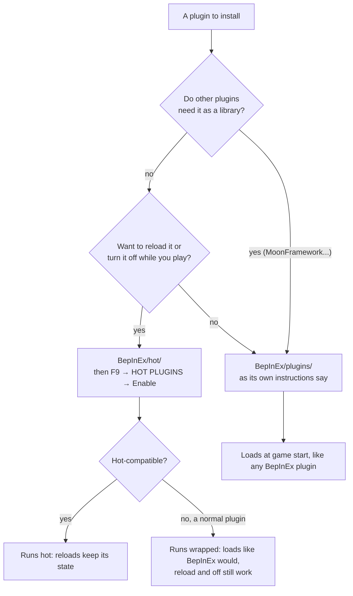

# Installing Plugins

With LunarLink installed, the game has **two plugin folders**. Which one a plugin goes in depends on whether it's
built to reload while the game runs.

| Folder | What goes there | Loaded by | Reloads and updates without a restart? |
|---|---|---|---|
| **`BepInEx/hot/`** | **Any plugin you want to reload or turn off while you play**: hot-compatible ones, and normal BepInEx plugins (they run wrapped, experimental) | LunarLink | **Yes**: reload, turn off, update from F9 |
| **`BepInEx/plugins/`** | **Every other plugin**, exactly as without LunarLink | BepInEx, once, at game start | No: a change needs a restart |

Nothing changes for plugins you leave in `BepInEx/plugins/`.

> **MoonFramework must stay in `BepInEx/plugins/`. It can't be hot-swapped.** Other plugins are built on it (Quantum
> Conveyors, building mods), and .NET doesn't let a plugin loaded the normal way use code that can be unloaded; a
> reloaded copy would also be a different library to every plugin built on the old one. It also runs the modded
> buildings standing in your world, so unloading it would pull them out from under your base. The same goes for any
> library other plugins are built on. LunarLink refuses one put in `BepInEx/hot/` and says so in F9.

## Hot-compatible or wrapped

A **hot-compatible** plugin has a class LunarLink can start and stop: `Start(string state)` and `Stop()` (see
[[Writing a Hot Plugin]]). Its README or mod page says so ("can be reloaded in place", "works hot with LunarLink").
Known ones: LunarLink's own modules, [Crew Tools](https://github.com/swheettaos/crewtools), Quantum Conveyors 2.1 and
later. A reload hands its state to the new copy.

**Any other BepInEx plugin runs wrapped** (**experimental**: see [[The Wrapper]]; while the LunarLink.Wrap module is on, as it is by default): it starts like
BepInEx would start it, and Reload and Disable undo what it started (its patches, threads, hooks, event handlers and
Unity objects). F9 shows it as **wrapped**, and its **?** says what the wrapper found. A plugin that hooks the game in a
way the wrapper can't undo still loads, but turning it off waits for a restart (F9 says **off at restart**). Details:
[[Hot Plugins]].

## Installing a plugin in hot/

1. Put it in **`BepInEx/hot/`**: its DLL straight in (`BepInEx/hot/CrewTools.dll`), or, if it brings files of its own
   (data, resources, other DLLs it needs), its whole folder named like its DLL
   (`BepInEx/hot/MarsSweepers/MarsSweepers.dll` with its files beside it).
2. **Make sure it isn't also in `BepInEx/plugins/`.** A plugin in both folders would load twice, so LunarLink refuses
   the hot copy and says so. To move one that's already installed normally, see the table below.
3. Start the game and turn it on in **F9 → HOT PLUGINS → Enable**. A new plugin starts off, so nothing runs just
   because a file appeared. It stays on from then on.

From then on: **Reload** in F9 loads a newer build without a restart, **Disable** stops it and unloads it, and if it
says where its releases are, F9 → **UPDATES** keeps it up to date (see [[Updates]]).

## Installing a normal plugin

As without LunarLink: put it in `BepInEx/plugins/` (usually in its own folder) with the game closed, and start the game.
F9 → **BEPINEX PLUGINS** then lists it with its version, and can turn it off or on for the next start.

## Moving a plugin between the folders

| From → to | How |
|---|---|
| `plugins/` → `hot/` | With the game closed, move its DLL (or its folder) into `BepInEx/hot/`; start the game; F9 → HOT PLUGINS → **Enable** |
| `hot/` → `plugins/` | F9 → HOT PLUGINS → **Disable** (it unloads at once); move its DLL into `BepInEx/plugins/`; restart |

See also: [[Hot Plugins]] (how loading and reloading work), [[Installing]] (LunarLink itself),
[[Troubleshooting]].
