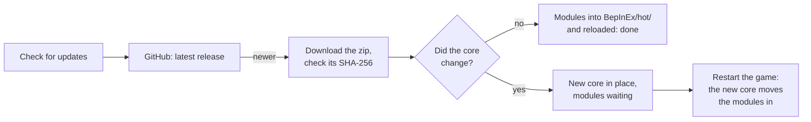
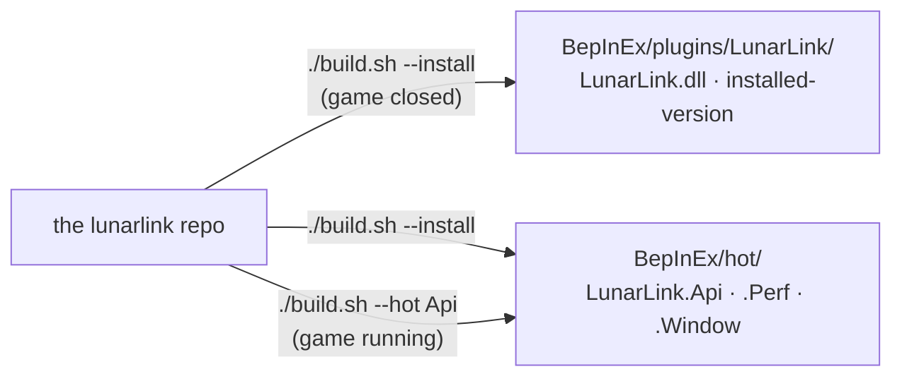

# Installing

## What you need

- **Moon Sweepers** with **BepInEx 6 (IL2CPP)**, run once so BepInEx has set itself up.
- That's all. **MoonFramework**, the framework many Moon Sweepers mods build on, isn't required: LunarLink starts
  after it when it's installed, and uses it only for Perf's power fix and for plugins that add buildings.
- To build from source (not needed for a release): the **.NET 8 SDK**.

## From a release

1. Download `LunarLink-<version>.zip` from [Nexus Mods](https://www.nexusmods.com/moonsweepers/mods/158) or the [latest release](https://github.com/swheettaos/lunarlink/releases/latest).
2. Close the game and unzip it into the game's folder, the one that holds `BepInEx/`. It adds
   `BepInEx/plugins/LunarLink/` (the core) and `BepInEx/hot/` (the modules).
3. Start the game.

## Your other plugins

**Hot-compatible plugins go in `BepInEx/hot/`; every other plugin stays in `BepInEx/plugins/`, as usual.** A plugin in
`BepInEx/hot/` reloads, turns off and updates while the game runs; one in `BepInEx/plugins/` loads once at game start,
exactly as without LunarLink. How to tell which is which, and how to move one: **[[Installing Plugins]]**.

## Updating

> **Only the core needs a restart.** Every module and every hot plugin updates in place while the game runs, however
> often it's updated. The core (`LunarLink.dll`) is loaded once by BepInEx, so a release that changes it says **restart
> to finish**. (A plugin installed the normal BepInEx way, in `BepInEx/plugins/`, needs a restart too; run it from
> `BepInEx/hot/` and it doesn't.)

**From the game:** press F9, and on the UPDATES tab press **Check for updates**. LunarLink asks GitHub for the latest
release (only then, unless you tick **Check for updates at game start**) and, when there's a newer one, offers
**Update**; the tab's name shows an orange count while anything has an update:



The download is checked against the SHA-256 GitHub publishes for it, and only LunarLink's own files are taken from it.
Modules you turned off stay off. Over HTTP it's `POST /update/check`, `GET /update` and `POST /update/apply` (see
[[API Reference]]).

**Module builds, between releases:** every change to `main` is built on GitHub, and the modules that changed are
published to the module channel (the `modules` prerelease). The UPDATES tab lists each module; one with a newer build
has an **Update** button: it's downloaded, checked against the SHA-256 in `modules.json` and reloaded in place, with no
restart. A module built for a newer core than yours says **needs next release** and waits for it. After a core update,
the game checks once more when it's back, so you get the module builds made since that release.

**Plugins that update themselves:** a plugin that says where its builds are (`UpdateFeed()`, see
[[Writing a Hot Plugin]]) gets a row on the UPDATES tab too, checked at the same time, from its GitHub releases or any
public HTTPS address it names.

**By hand:** unzip the new release over the old files with the game closed. Each release's notes say what changed
([CHANGELOG](https://github.com/swheettaos/lunarlink/blob/main/CHANGELOG.md)).

## Build and install from source

```bash
git clone https://github.com/swheettaos/lunarlink.git
cd lunarlink
./build.sh --install      # with the game closed
```

The project builds against the game's own DLLs. By default it looks for the game in
`~/.local/share/Steam/steamapps/common/Moon Sweepers`; set `MOON_GAME_DIR` if yours is elsewhere. The SDK is expected
in `~/.dotnet` (or on your `PATH`).



`build.sh --install` puts:

| What | Where |
|---|---|
| The core, `LunarLink.dll` | `BepInEx/plugins/LunarLink/` |
| The modules: `LunarLink.Api` (the endpoints), `LunarLink.Perf` (measuring and fps fixes), `LunarLink.Window` (F9), `LunarLink.Update` (updates) | `BepInEx/hot/` |
| The build's stamp | `BepInEx/plugins/LunarLink/installed-version` |

New modules are turned on in `BepInEx/hot/hot.json`; a module you turned off yourself stays off.

## Check it

Start the game and load a moon (LunarLink waits for the loading screen to finish), then:

```bash
curl -s 127.0.0.1:8765/status
```

The `version` it reports matches `installed-version`. If it's older, the game is still running the previous build:
restart the game.

## Allow changes

Reading works straight away. To build, remove, teleport or change settings through the API, create the file:

```bash
touch "<game>/BepInEx/plugins/LunarLink/allow-writes"
```

Delete it to make LunarLink read-only again. See [[Settings]].

## Updating a build from source

- The **core** (`LunarLink.dll`) loads only at game start: `./build.sh --install` with the game closed, then start it.
- A **module** reloads while the game runs: `./build.sh --hot Api` (or `Perf`, `Window`). See [[Hot Plugins]].
