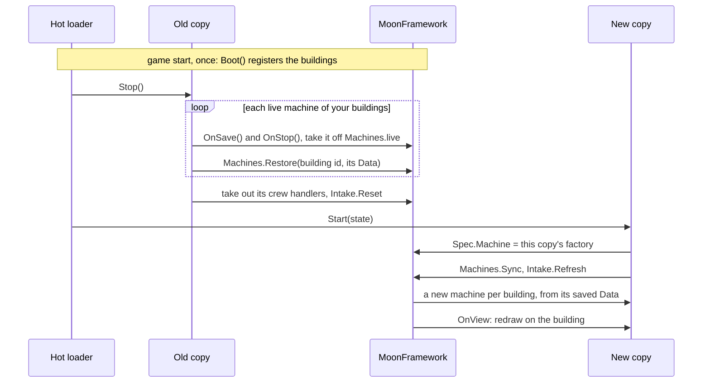

# Plugins with Buildings

> **MoonFramework itself must stay in `BepInEx/plugins/`. It can't be hot-swapped.** Your plugin is the hot part:
> MoonFramework stays loaded underneath it and keeps its buildings registered across reloads.

MoonFramework lets a plugin add buildings (`Moon.RegisterBuilding`) with a machine behind each one. That needs two
extra steps to reload, because of how MoonFramework works:

- **It only accepts new buildings at start-up**, before its build menu is set up, and it can't unregister one.
- **It keeps one machine object per placed building** for as long as the game runs.

## Register in `Boot()`

LunarLink calls a hot plugin's `static void Boot()` once, at game start, from the first copy it loads (it loads after
MoonFramework for this). Register your buildings there. A reload doesn't call `Boot()` again, so the building's
**definition** - its model, ports, price, name - only changes with a game restart. Everything its machine **does**
reloads.

```csharp
public static void Boot() => Moon.RegisterBuilding(new BuildingSpec
{
    Id = "myplugin.box", Name = "Box", /* ... */
    Machine = () => new BoxMachine(),
});
```

A plugin with `Boot()` that is turned on after the game started can't register its buildings until a restart;
`/hot/list` says `"boot": "restart to boot"`.

## Swap the machines on a reload

MoonFramework makes a machine from `building.Spec.Machine` whenever a placed building has none, keeps each machine's
saved data in `machine.Data`, and can be handed that data back for the next machine it makes. So a reload swaps every
live machine for the new copy's, from the same data:

1. **`Stop()`** of the old copy: for each live machine of your buildings, call `OnSave()` (so its state is in `Data`)
   and `OnStop()`, take it off MoonFramework's live list, and give its `Data` back to MoonFramework for that building id.
2. **`Start()`** of the new copy: put this copy's factory on the building (`Moon.BuildingOf(id).Spec.Machine = () => new
   BoxMachine()`), then have MoonFramework create the machines at once (it otherwise does so within half a second).
   MoonFramework gives each new machine its building's view again, which calls `OnView`.

The live list, the hand-back and the immediate refresh are inside `MoonFramework.Internal` (`Machines.live`,
`Machines.Restore`, `Machines.Sync`, `Intake.Refresh`), reached by reflection.



## Other things to undo in `Stop()`

- **Crew messages**: `Crew.On` has no remove call. Take your handlers out of MoonFramework's handler lists (those whose
  method's assembly is yours).
- **The input table**: clear it (`Intake.Reset`) after removing machines, so nothing offers a capsule to a stopped
  machine before the new ones exist.
- **Visual changes on the buildings' views** (materials, extra objects): the new copy redraws them on `OnView`; leave
  or destroy the old ones, but don't leave two drawing at once.

With this, a reload of a plugin with hundreds of placed buildings takes about a tenth of a second, and every building
keeps its saved state.
