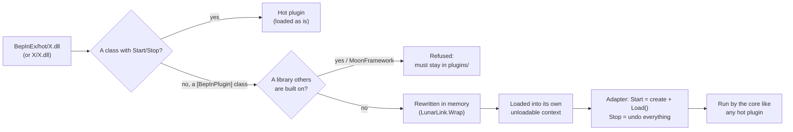
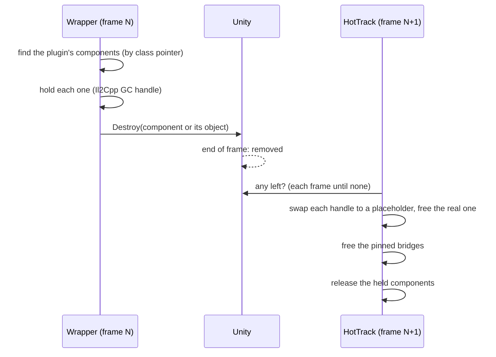

# The Wrapper (experimental)

> **Experimental.** The wrapper is new. It works on the plugins it has been tested with, but every plugin is
> different: try a plugin's **Reload** and **Disable** once, on a save you don't mind, before you rely on them. If
> something goes wrong, move the plugin back to `BepInEx/plugins/` and restart, and please
> [open an issue](https://github.com/swheettaos/lunarlink/issues) with the support file (F9 → **Support file**).

The wrapper lets a **normal BepInEx plugin**, one never written for LunarLink, live in `BepInEx/hot/` and be
**reloaded and turned off while the game runs**, like a hot plugin. It's the **LunarLink.Wrap** module, which is on
by default.

- [What it's for](#what-its-for)
- [Using it](#using-it)
- [What "wrapped" means in practice](#what-wrapped-means-in-practice)
- [Example: why Mars Sweepers reloads at the main menu](#example-why-mars-sweepers-reloads-at-the-main-menu)
- [What it can't do](#what-it-cant-do)
- [How it works](#how-it-works)
  - [1. Deciding to wrap a DLL](#1-deciding-to-wrap-a-dll)
  - [2. Rewriting the DLL](#2-rewriting-the-dll)
  - [3. Loading and starting](#3-loading-and-starting)
  - [4. Turning it off](#4-turning-it-off)
  - [5. Unity objects and Il2Cpp types](#5-unity-objects-and-il2cpp-types)
  - [6. Reloading](#6-reloading)
  - [7. Memory](#7-memory)
- [Where the code lives](#where-the-code-lives)
- [Seeing what it did](#seeing-what-it-did)
- [For plugin authors](#for-plugin-authors)
- [Troubleshooting](#troubleshooting)

## What it's for

BepInEx loads each plugin once, at game start, and never lets go of it. To try a new build or turn a plugin off you
quit the game, change files and load your save again. LunarLink's [[Hot Plugins]] avoid that, but only for plugins
written for it (a class with `Start(state)` and `Stop()`). The wrapper covers everything else: it does from the outside
what a hot plugin does for itself.

| | Hot plugin | Wrapped plugin | Normal plugin in `plugins/` |
|---|---|---|---|
| Written for LunarLink | Yes | No | No |
| Reload while playing | Yes, keeps its state | Yes, starts fresh | No |
| Turn off while playing | Yes, leaves memory | Yes, see [Memory](#7-memory) | Next start only |
| In-game updates (F9 → UPDATES) | If it has an update feed | If it has an update feed | Restart to apply |
| Status | Stable | **Experimental** | As BepInEx |

## Using it

1. With the game closed, move the plugin from `BepInEx/plugins/` into `BepInEx/hot/`:
   - **one DLL**: straight in, `BepInEx/hot/ZeroG.dll`;
   - **a DLL with files of its own** (data, resources, other DLLs): its whole folder, named like its DLL,
     `BepInEx/hot/MarsSweepers/MarsSweepers.dll` with its files beside it.
2. Make sure no copy is left in `BepInEx/plugins/`: a plugin in both would load twice, so LunarLink refuses the hot one.
3. Start the game and turn it on in **F9 → HOT PLUGINS → Enable** (a new plugin starts off). It stays on from then on,
   and loads at game start like it did from `plugins/`.

**Never move MoonFramework.** It must stay in `BepInEx/plugins/`: it can't be hot-swapped (see
[What it can't do](#what-it-cant-do)).

To go back: **Disable** it in F9, move it back to `BepInEx/plugins/`, restart.

## What "wrapped" means in practice

- **At game start** it loads where BepInEx would load it: right after BepInEx has loaded its own plugins, before the
  game sets up its buildings. A plugin that needs to be early still is.
- **Reload** (F9, or `POST /hot/reload?name=`): it's turned off (below), and the DLL on disk is loaded and started
  again. It starts fresh, like at game start: whatever it kept in memory is gone, its settings file is read again.
- **A plugin that loads its own content** (asset bundles, as Mars Sweepers does for its planet) sets things up when a
  world loads, which a copy swapped in mid-game would miss: the game then refuses to save. So while a world is loaded,
  its **Reload waits for the main menu**: the row turns orange ("reloads at main menu") with **Save & reload** and
  **Cancel**. Save & reload does the whole round trip in one click: the game's own save, back to the menu, the reload
  there, then your save loaded again by the menu's own Play (what a click on it runs, so other mods' hooks on it run
  too). With anyone else in your lobby it's **Save & menu** instead, since leaving the world ends the session for
  them; pick your save again yourself. There's no forcing a reload mid-world. At the main menu, or for any other
  wrapped plugin, Reload works at once.
- **Its choices survive a reload:** its static enum settings (modes and choices, such as Mars Sweepers' MOON / MARS)
  are carried from the old copy to the new one. Flags and counters start fresh, so it still sets itself up.
- **A reload that keeps failing is stopped:** for 10 s after any reload, errors from the plugin's code are counted;
  at 20 it's stopped and its row says to restart the game (it stays on, so the next start loads it cleanly).
- **Disable**: it's turned off and stays off, also at the next start, until you enable it.
- **Its settings** (`BepInEx/config/<its id>.cfg`) are its own, as before. A reload reads them again, so a setting
  that says "restart after changing" usually only needs a reload.
- **Its log** lines still show under its own name.
- F9 marks it **wrapped**, and its **?** lists what the wrapper found in it.

## Example: why Mars Sweepers reloads at the main menu

[Mars Sweepers](https://www.nexusmods.com/moonsweepers/mods/148) adds a whole second planet. It's a normal BepInEx
plugin, so it runs wrapped, and it shows why some plugins can only be reloaded with **no world loaded**, and why that's
still far quicker than restarting the game.

### What Mars Sweepers does, and when

| When | What it does |
|---|---|
| **Game start** (its `Load()`) | Registers its own Unity types (its atmosphere, machine views, menu input), patches the game's code (Harmony), and prepares the Mars grid and terrain data in the background. |
| **The first time it needs its content** | Loads `mars-content`, a Unity **asset bundle** beside its DLL with its models, textures and materials. |
| **A Mars save loads** | Sets up the planet *as the world is built*: the 327,600 sectors, the four stations, the terrain, the atmosphere, and its production machines' state, which it tracks itself and writes into the save alongside the game's. |
| **Every save** | Writes its Mars production data beside the game's save (and blocks the write when it holds none for this world). |

Two things here can't simply be swapped out while a Mars world is running.

### 1. Its content: Unity loads a bundle only once

Unity refuses to load an asset bundle that's already loaded. Mars Sweepers was written to load its bundle once and keep
it for the whole session, since a normal plugin is never stopped. So when its copy was swapped mid-game, the new copy
asked for `mars-content`, Unity said no, and Mars Sweepers threw *"Mars content is missing or could not be loaded"*
every time the game drew a dust canister: about one frame a second.

The wrapper now fixes that part for any plugin: it notes every asset bundle a wrapped plugin loads, and unloads them
when that copy stops, so the next copy can load them again.

### 2. Its world: set up as the world loads, not afterwards

Everything in the third row of the table happens **while the save loads**, and only then. A copy started in the middle
of a game wasn't there for it: it has no idea the world's sectors, stations and machines are Mars's, and it holds none
of the production state the old copy tracked. Tested with a forced reload: the new copy ran, the content loaded, but
Mars's atmosphere was gone, and at the next save the game's own check (it reads a save back before keeping it) found
the save couldn't be read, so the game **refused to write it** (*"A save the game couldn't load again wasn't written (the one before stays)"*). Nothing was damaged,
but nothing could be saved from then on.

No code of LunarLink's can rebuild that set-up for a plugin: only the plugin knows what it does when a world loads, and
the only way to make it do that again is to load the world again.

### Why the main menu fixes it

At the main menu **no world is loaded**, so nothing depends on the old copy's world state. That's where the wrapper
reloads it:

1. The old copy stops: its patches come out, its Unity objects go, its **asset bundle is unloaded**.
2. The new copy loads and runs its `Load()`, exactly as at game start.
3. You load the Mars save: the new copy is there from the start, so it sets the planet up as it always does, and
   everything (content, atmosphere, machines, saving) works.

That's why, in a world, a plugin like this shows **reloads at main menu** in F9, with **Save & reload**: the game's own
save, the game's own way back to the menu, the reload there, and your save loaded again through the menu's own Play.
Mars Sweepers hooks that Play to set up its planet session, so loading the save any other way (the start step under
it) would be stopped by Mars; going through the button you'd click lets it do its part. Tested: click to playing
again in about 23 seconds. There's deliberately no way to force it mid-world, since that ends in a world that can't be
saved.

### Why that's better than restarting the game

| | Main menu reload | Restarting the game |
|---|---|---|
| What happens | Only that plugin is swapped; the game keeps running | The whole game closes and starts again |
| What stays loaded | The game, BepInEx, LunarLink, every other plugin, their state | Nothing |
| What you do | One click (**Save & reload**) | Quit, start the game, pick your save |
| What you wait for | Saving, the menu, then your save loading again | Steam, the game's start-up, BepInEx and every plugin loading, the menu, then your save loading |
| Typical time | About 25 s with Mars Sweepers | Minutes |

A restart is still needed for LunarLink's own core, and for a plugin that hooks the game natively in a way the
wrapper can't undo (F9 says **off at restart** for those).

**Better still:** if Mars Sweepers itself became a hot plugin ([Plugins that set up the world](Writing-a-Hot-Plugin#plugins-that-set-up-the-world)),
it would reload in place mid-game with no menu at all: `StartEarly`, its planet set up in `WorldLoaded()`, and its
machines' state handed to the new copy.

**Which plugins wait:** only wrapped plugins that load asset bundles, which the wrapper sees as it loads them (F9's **?**
says so). Every other plugin reloads at once, anywhere, as before. Plugins written for LunarLink (Crew Tools, Quantum
Conveyors, Who Left The Light On?) hand their state to the new copy themselves, so they never need the menu.

One limit remains even at the menu: if a plugin added things to the game's own menus at start (Mars Sweepers' MOON /
MARS switch, say) and its old copy doesn't take them away, the new copy may add them again. If anything looks doubled
after a reload, a restart clears it.

## What it can't do

- **Libraries. MoonFramework must stay in `BepInEx/plugins/`.** A plugin other plugins are built on can't be
  hot-swapped: .NET doesn't let a plugin loaded the normal way use code that can be unloaded, and a reloaded copy would
  be a different library to every plugin built on the old one. MoonFramework also runs the modded buildings standing in
  your world. The wrapper refuses MoonFramework, and any DLL another installed plugin is built on, with a message in F9.
  Plugins that *use* MoonFramework can be hot; it stays loaded underneath them.
- **Native hooks it can't see.** Hooks made through BepInEx's `INativeDetour` or MonoMod are tracked and undone. A
  plugin that hooks the game some other way (its own calls into a hooking library, raw function pointers) can still be
  wrapped, but turning it off or reloading it **waits for the next start**: removing its code while the game still
  jumps into it would crash. F9 shows **off at restart**.
- **Long-running tasks** started with `Task.Factory.StartNew(..., LongRunning)` or similar aren't tracked and may keep
  running after it's off. F9 warns about them.
- **What it changed, as opposed to what it started.** Turning a plugin off undoes what it *started* (patches,
  threads, hooks, handlers, objects), not what it *did*: game settings it changed, data it laid out its own way, files
  it wrote. Most plugins are fine with that; a plugin that rewires game data may leave the game in its shape until a
  restart. This is the main reason it's experimental: test off and on once.
- **Adding new buildings mid-game.** The game sets up its buildings once, at start. A building mod loads fine at game
  start and its code reloads, but buildings it adds only appear after a restart.
- **State across a reload.** A hot plugin hands its state to the new copy; a wrapped one can't, so it starts fresh.

## How it works



### 1. Deciding to wrap a DLL

When LunarLink loads a DLL from `hot/`, it hands the bytes to the wrapper first. The wrapper reads them with
Mono.Cecil (nothing is loaded yet) and wraps the DLL only if:

- it has **no** public class with `Start(string)` and `string Stop()` (that would make it a hot plugin), and
- it has a class with **`[BepInPlugin]`** (a normal BepInEx plugin), and
- it's **not MoonFramework**, and **no other plugin** in `BepInEx/plugins/` or `BepInEx/hot/` is built on it (it
  checks every DLL's references).

Anything else is loaded as before. If the wrapper module is off, a normal plugin in `hot/` fails to load with a
message saying the module is needed.

### 2. Rewriting the DLL

The wrapper changes the plugin's code in memory, never on disk. Each change sends a call through LunarLink, so that
LunarLink knows about everything the plugin starts and can undo it later. The rewritten calls go to `HotTrack`, which
lives in LunarLink's core; each copy of a plugin gets its own record there.

| The plugin's code does | It's rewritten to | So that turning it off can |
|---|---|---|
| `new Thread(start)` (all four constructors) | `HotTrack.NewThread(start, …)`: the same thread, its body run inside a guard | interrupt it and let it end cleanly |
| `new Timer(...)` (`System.Threading`, `System.Timers`) | the same, then recorded | dispose it |
| a native hook: anything returning or creating a BepInEx `Hook` type (`INativeDetour.CreateAndApply`...) or a MonoMod `RuntimeDetour` type (`Detour`, `Hook`, `NativeDetour`, `ILHook`) | the same, then recorded | dispose it, which takes the hook out of the game's code |
| `something.add_Event(handler)` on another assembly's type (C# `+=` on another mod's or the game's event) | the same, then recorded with its `remove_Event` | remove the handler |
| `assembly.Location` | `HotTrack.Location(assembly)` | (nothing to undo: a plugin loaded from memory has no location, so it's told its DLL's path, and finds files beside it) |
| its own Unity types (classes made for Il2Cpp: a constructor taking an `IntPtr`) | renamed in each later copy: `Driver` → `Driver_hot2` | (see [Reloading](#6-reloading)) |

How each rewrite keeps the code valid:

- **Threads**: the `newobj Thread` instruction becomes `ldc.i4 <id>` followed by a call to `HotTrack.NewThread`,
  which returns a `Thread`, so the stack is unchanged.
- **Timers and hooks**: after the instruction that makes one, `dup` + `ldc.i4 <id>` + `call HotTrack.Keep` record
  a copy of the reference and leave the original on the stack.
- **Events**: the `add_` call itself becomes "store the handler", so any branch that jumped to the call still lands
  on the right instruction. Then come: store the target, load both, the original `add_` call, and a call to
  `HotTrack.Event` with the target, the handler and a token for the matching `remove_` method. Only reference types
  from other assemblies are rewritten; the plugin's own events go away with it.
- Short branches are widened before the changes and narrowed again after (`SimplifyMacros` / `OptimizeMacros`).
- Writing the DLL back resolves its references from `BepInEx/core`, `BepInEx/interop`, `BepInEx/plugins` (every
  folder) and `BepInEx/hot`.

What it **can't** track is reported instead of rewritten: calls to `Marshal.GetFunctionPointerForDelegate`, and
P/Invokes of memory protection or of hooking libraries (Dobby, MinHook), mark the plugin **native**: it can't be turned
off until a restart. `TaskCreationOptions` (long-running tasks) gets a warning.

Every method of the rewritten DLL is checked by compiling it in tests (ZeroG: 728 methods, MarsSweepers: 1,764): a
rewrite that broke code would show there.

### 3. Loading and starting

```mermaid
sequenceDiagram
  participant B as BepInEx
  participant C as LunarLink core
  participant W as LunarLink.Wrap
  participant P as The plugin
  B->>C: LunarLink.Load() (a normal plugin)
  C->>C: load LunarLink's modules first
  C->>W: Boot(): fill the wrapper slot
  C->>W: Prepare(bytes): wrap it?
  W-->>C: rewritten bytes, notes, warnings
  C->>C: load them into the plugin's own context
  C->>W: Adapt(assembly): the object to run
  W-->>C: Adapter (Start / Stop)
  B->>C: Finished (all normal plugins loaded)
  C->>W: Adapter.Start()
  W->>P: new Plugin(); plugin.Load()
```

- Each copy is loaded into its own **collectible load context**, like every hot plugin, from memory (so its file can be
  replaced while it runs). A plugin in its own folder (`hot/X/X.dll`) also gets the other DLLs in that folder loaded
  into the same context when it asks for them.
- LunarLink's own modules load first, so the wrapper is there before any plugin it wraps.
- The **Adapter** is the object the core runs, with `Start` and `Stop` like any hot plugin. `Start` creates the plugin
  (its `BasePlugin` constructor makes its log source and opens its settings file, as under BepInEx) and calls its
  `Load()`. `HandleHttp`, `HttpHelp` and `UpdateFeed` are passed on to the plugin if it has them, so a wrapped plugin can
  serve endpoints and update itself.
- At game start the core runs wrapped plugins when BepInEx raises **Finished** (it has loaded its own plugins). Turned
  on later, one starts at once.

### 4. Turning it off

Off (Disable, or the first half of a Reload) runs in this order:

1. **Its own `Unload()`**, if the plugin overrides `BasePlugin.Unload()`. If it returns false, that's noted.
2. **Its threads stop.** Each tracked thread is interrupted, and LunarLink waits up to 2 seconds for them all. A thread
   blocked in a wait (`Wait`, `Sleep`, `Join`, a semaphore) wakes with `ThreadInterruptedException`; the guard around
   its body catches it, so it ends instead of crashing the game. The guard also detaches the thread from the game's
   runtime (Il2Cpp) if it attached itself, so the game's garbage collector doesn't wait on a thread that's gone. A
   thread busy without ever waiting is reported as still running. Threads go first because one may be in the middle
   of a hook.
3. **Its hooks and timers are undone**, newest first: each one is disposed. For a native hook that puts the game's
   original code back.
4. **Its event handlers are removed** from the events it added them to.
5. **Its Unity objects are destroyed** (next section).
6. **Its log source is removed.**
7. Then the core does what it does for every hot plugin: takes out **every Harmony patch** whose patch method lives in
   the plugin, removes any **endpoints** it added, and drops its **load context**.

What couldn't be undone shows as **leftovers** in F9 and `/hot/list`.

### 5. Unity objects and Il2Cpp types

A plugin that adds its own `MonoBehaviour` has it registered in the game's runtime (Il2Cpp) by Il2CppInterop. Three
things then keep that plugin's code alive, and the wrapper deals with each.

**The objects.** Every component of the plugin's Unity types is found, hidden ones included
(`BasePlugin.AddComponent` puts them on BepInEx's hidden manager object), and destroyed. A game object that held only
the plugin's components goes too, unless it's BepInEx's own. They're destroyed with `Destroy`, at the end of the frame,
not `DestroyImmediate`: the request runs inside LunarLink's own per-frame update, which sits on that same BepInEx
object, and tearing a neighbour out mid-update crashes the game. The plugin's types are recognised by their native
class pointer: asking the game's runtime for an injected type's name crashes it.

**The handles back to the old code.** A destroyed component lives on in the game's memory until the game's garbage
collector finalizes it, holding a handle to its .NET object and so to the whole old copy. The wrapper holds each
destroyed component (so it can't be finalized too early), and once Unity has removed them all, it points each handle
at an empty placeholder and frees the real one. The old copy is let go at once; the game's finalizer later frees the
placeholder.

**The bridges.** Il2CppInterop builds a bridge for every method of a registered type and pins it for good. While a
wrapped plugin registers a type, LunarLink records those pins (it patches the two methods in Il2CppInterop that make
them), and frees them once the objects are gone, when nothing can call them any more.



### 6. Reloading

A reload is off, then load and start the DLL on disk. Off unloads the asset bundles the plugin loaded (the rewrite
keeps every `AssetBundle` a call hands back, Unity's loaders or the plugin's own helper alike): Unity loads a bundle
only once, so a copy that left its bundle loaded would stop the next copy from loading it. A plugin that loads
bundles reloads only at the main menu while a world is loaded (see above). Il2Cpp never forgets a registered type's name, and refuses a
second type with the same name, so from the second copy on the plugin's own Unity types are renamed as it's rewritten:
`PerfDriver` in copy 1, `PerfDriver_hot2` in copy 2, `PerfDriver_hot3` in copy 3. The plugin's code refers to its
types directly, so the rename is invisible to it. A plugin that looks a type up by its name string would not find the
renamed one.

### 7. Memory

`GET /hot/list?gc=1` shows how many old copies of each plugin are still in memory (`oldCopiesAlive`). A wrapped plugin
that only patches the game, starts threads and hooks, and adds Unity objects leaves memory completely after off or
reload.

**Known:** a plugin that Harmony-patches **another mod's** .NET code (MoonFramework's, for example), rather than the
game's, keeps each old copy in memory after a reload. MonoMod, which Harmony uses for that, holds on to the old patch
code. This affects proper hot plugins too. The plugin still reloads and turns off correctly; it only costs that copy's
memory (usually well under a megabyte) until the game restarts.

## Where the code lives

The wrapper is split so that improving it never needs a game restart:

| Part | Where | What | Reloads |
|---|---|---|---|
| `HotTrack` (`src/LunarLink/Track.cs`) | the core | What rewritten plugins call: the thread guard, the records of timers, hooks and events, `Location`; the pinned bridges; letting go of destroyed objects | No (game start). Kept small and stable, because running wrapped plugins call into it |
| `IWrapper` slot (`src/LunarLink/Wrapping.cs`, `Hot.cs`) | the core | Where the loader asks the module to prepare and adapt a DLL | No |
| `LunarLink.Wrap` (`src/LunarLink.Wrap/`) | `BepInEx/hot/` | Deciding, rewriting (`Rewriter.cs`), starting and stopping (`Adapter.cs`), destroying objects | **Yes**: a reload takes effect for plugins loaded after it |

Reloading or turning off **LunarLink.Wrap** doesn't touch plugins it already wrapped: they keep their adapter (and
that copy of the module stays in memory) until they're reloaded or turned off themselves.

## Seeing what it did

- **F9 → HOT PLUGINS**: a wrapped plugin is marked **wrapped**; its **?** lists what's tracked ("1 thread, 1 native
  hook"), whether it asks for its location, and anything it can't undo. **off at restart** means it hooks natively in a
  way that waits for a restart.
- **`GET /hot/list`**: `"wrapped": true`, `"warnings"` (the same list), `"leftovers"` (what an off couldn't undo),
  and with `?gc=1`, `oldCopiesAlive`.
- **`BepInEx/plugins/LunarLink/requests.log`** (the journal) has a line for each step:
  `hot: loaded ZeroG (copy 2, wrapped)`, `hot: stopped 4 thread(s), undid 1 hook(s)/timer(s), removed 0 event
  handler(s)`, `hot: destroying 1 component(s) ...`, `hot: MoonPerformance's objects are gone: let go of 1, freed 12
  Il2Cpp bridge(s)`.

## For plugin authors

Nothing is needed for your plugin to be wrapped. To make it work best:

- **Override `Unload()`** in your `BasePlugin` and undo what you did that the wrapper can't see (game settings you
  changed, data you rewired). Return true. BepInEx doesn't call it; the wrapper does.
- **Hook natively through BepInEx's `INativeDetour`** (or MonoMod), not your own hooking library, so the hook can be
  undone.
- **Don't look up your own types by name string**: from the second copy on they're renamed.
- **Read files beside your DLL with `Assembly.Location`** (it's answered), and ship them in a folder named like your
  DLL.
- Or go all the way: a class with `Start(state)` and `Stop()` makes your plugin a real hot plugin, which keeps its
  state across a reload and needs no rewriting. See [[Writing a Hot Plugin]].

## Troubleshooting

| You see | What it means |
|---|---|
| **failed**: "a normal BepInEx plugin runs here only while the LunarLink.Wrap module is on" | Turn on LunarLink.Wrap (F9, with modules shown) and reload the plugin |
| **failed**: "... must stay in BepInEx/plugins/ and can't be hot-swapped" | It's MoonFramework or a library another plugin is built on: move it back to `BepInEx/plugins/` and restart |
| **off at restart** after Disable | It hooks the game natively in a way the wrapper can't undo: it stops at the next start |
| **leftovers**: "thread(s) didn't stop" | A thread busy without ever waiting: it keeps running until a restart |
| **leftovers**: "its Unload() said it couldn't unload everything" | The plugin's own `Unload()` returned false |
| The game behaves oddly after Disable | The plugin changed something it doesn't undo itself: restart, and keep that plugin on (or in `BepInEx/plugins/`) |
| It can't find its files | Put it in a folder named like its DLL, with its files beside it: `BepInEx/hot/<Name>/<Name>.dll` |
| `oldCopiesAlive` grows | See [Memory](#7-memory); harmless until a restart |
| The game crashes on Reload or Disable | Please report it with the support file: [issues](https://github.com/swheettaos/lunarlink/issues). Then move the plugin back to `BepInEx/plugins/` |

See also: [[Hot Plugins]], [[Installing Plugins]], [[How It Works]].
