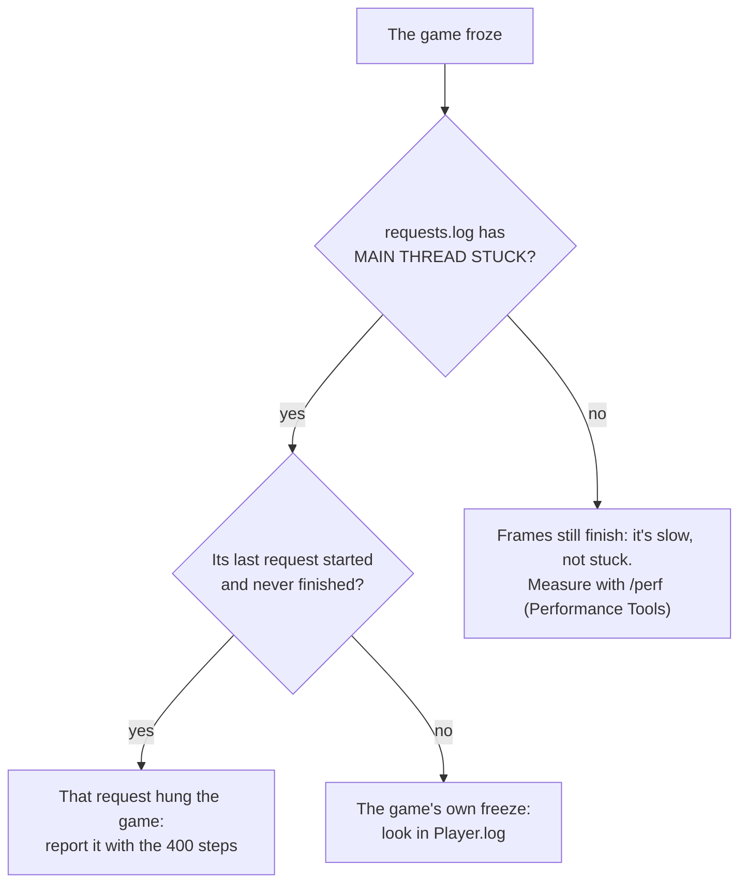

# Troubleshooting

## The API doesn't answer

| Symptom | Cause |
|---|---|
| Nothing on port 8765 | The game isn't running, or LunarLink didn't load: look for `LunarLink` in `BepInEx/LogOutput.log` |
| Nothing until a moon is loaded | By design: LunarLink waits for the game's loading screen to finish (answering during loading froze the game) |
| `{"error":"no world loaded yet"}` | You're at the main menu: only `/status` and `/hot/*` answer there |
| `{"error":"writes disabled (no allow-writes file)"}` | Create `BepInEx/plugins/LunarLink/allow-writes` (see [[Settings]]) |
| `{"error":"use POST for ..."}` | Changes are POST, reads GET (see [[Using the API]]) |
| Another machine gets 403 | It needs the access key, or none is set (see [[Settings]]) |
| `/status` shows an older `version` than `installed-version` | The game still runs the previous core: restart it |

## The game froze

Look at `BepInEx/plugins/LunarLink/requests.log` first. Every request is written as it starts and finishes, and a
watcher thread writes **`MAIN THREAD STUCK`** with the last 400 steps when no frame has finished for 3 s. A request
that started and never finished is where it hung; no request at all means the freeze was the game's own.

Common causes:

- **Removing many structures at once.** The game's removal costs 100-130 ms straight after another; remove one at a time
  with about 0.25 s between.
- **The game's own start-up check** of unfinished sections can hang at load; `Player.log` (in the game's
  `AppData/LocalLow/.../MoonSweepers/` folder) shows it.

`GET /debug/threads` lists the game process's threads (state, CPU time, when each started), which helps when the game
hangs but still answers.

## A hot plugin

| What you see in F9 or `/hot/list` | What it means |
|---|---|
| `failed` and an error | It didn't load (no class with `Start`/`Stop`, a missing reference), or `Start`/`Update` threw. Fix and reload |
| `disabled` after you dropped it in | New DLLs start off: enable it |
| "is also in BepInEx/plugins/" | The same plugin is installed the normal way: turn that copy off (BEPINEX PLUGINS tab) and restart |
| `leftovers` | A Harmony patch was still in after `Stop()`; LunarLink took it out. Unpatch it in `Stop()` |
| `oldCopiesAlive` growing (`?gc=1`) | Something still points at an old copy (a UI listener, an event): remove it in `Stop()` |
| `"boot": "restart to boot"` | It registers buildings and was turned on after start-up: restart once |

## Updates

| What the UPDATES tab says | What it means |
|---|---|
| **updates off** | The `LunarLink.Update` module isn't running: turn it on in HOT PLUGINS (tick Show LunarLink modules) |
| **needs a newer core** (a module) | That module was built for a newer LunarLink core than yours: it comes with the next release, which needs one restart |
| **restart to finish** | A new core is in place: restart the game; it moves the new modules in and checks again |
| **failed**: "doesn't match ... SHA-256" | The download wasn't the file published: nothing was installed. Check again; if it keeps failing, report it |
| **failed**: "check: ..." | GitHub (or a plugin's host) couldn't be reached: no internet, a firewall, or GitHub's rate limit (60 checks an hour per address) |
| **failed** (a plugin): "UpdateFeed() must answer ..." | The plugin's `UpdateFeed()` returned something that isn't `github:owner/repo` or an `https://` address: tell its author |
| A plugin doesn't appear | It has no public `string UpdateFeed()` (on its hot class, or its BepInEx plugin class): it doesn't update itself |

See [[Updates]].

## The window

- **F9 does nothing**: the window module may be off or failed: `GET /hot/list`, then `POST
  /hot/reload?name=LunarLink.Window`.
- **The key clashes with another mod**: change `Window key` in `lunarlink.cfg`.
