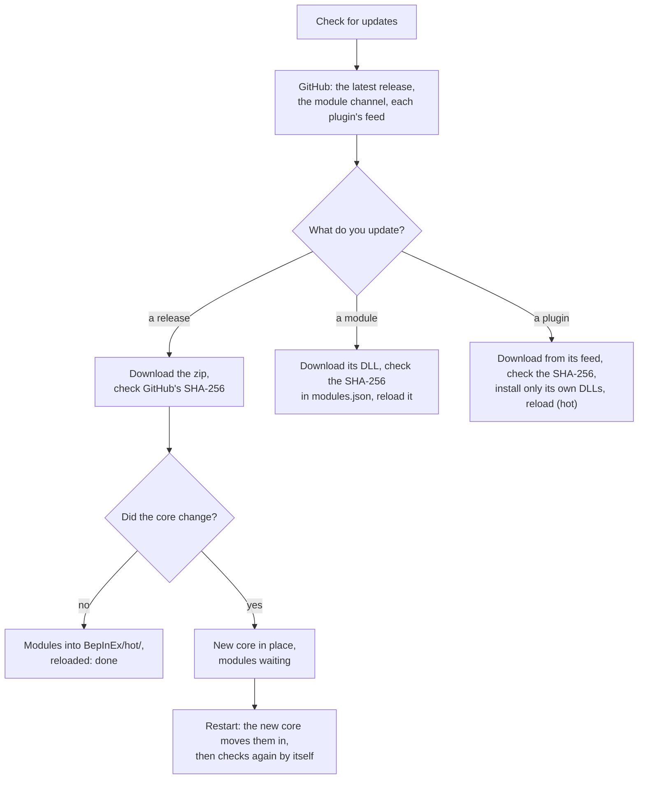

# Updates

LunarLink updates itself, and any plugin that says where its builds are, from the game: F9's **UPDATES** tab. Checking
is **manual by default**: nothing is checked until you press **Check for updates**. Tick **Check for updates at game
start** to have it check once by itself at every game start (after the moon loads). Either way, nothing is installed
until you press **Update**, and the tab shows an orange count (**UPDATES ●2**) whenever something has an update. Every download
is checked against a SHA-256 first.

> **Only the core needs a restart.** Every module and every hot plugin updates in place while the game runs, however
> often it's updated. The core (`LunarLink.dll`) is loaded once by BepInEx, so a release that changes it says **restart
> to finish**. (A plugin installed the normal BepInEx way, in `BepInEx/plugins/`, needs a restart too; run it from
> `BepInEx/hot/` and it doesn't.)

## What the UPDATES tab lists

| Row | Where it comes from | Installing it |
|---|---|---|
| **LunarLink x.y.z** | The latest [release](https://github.com/swheettaos/lunarlink/releases/latest) | If the core is unchanged, its modules reload in place. If the core changed, it's put in place for the next start: the row says **restart to finish** |
| **LunarLink.Api**, **.Perf**, **.Window**, **.Update** | The **module channel**: each module as built from `main`, between releases | It reloads in place, no restart. A module built for a newer core says **needs a newer core** and comes with the next release |
| **A plugin** | Wherever its `UpdateFeed()` says: a GitHub repo's releases, or any public HTTPS address | A hot plugin reloads in place; a normal plugin's DLL is swapped for the next start |

**Module versions.** In a release every module has the release's number (1.1.0). Each later build of a module on the
channel counts up from it: 1.1.0.1, 1.1.0.2, and so on; the next release starts again at its own number. F9 shows each
module's version on HOT PLUGINS, and UPDATES says which one is available and which you have ("1.1.0.2 available, you
have v1.1.0.1"). A module you built yourself shows as **dev build**.

**Update all modules** (top) updates every module with a newer build at once. The same is available over HTTP:
`POST /update/check`, `GET /update`, `POST /update/apply` (`?module=`, `?plugin=`); see [[API Reference]].

## How an update runs



- **Why some updates need a restart:** the core (`LunarLink.dll`) is loaded by BepInEx once, at game start. A new core
  is written in place of the running one (the running file is renamed to `LunarLink.dll.old`, which a loaded DLL
  allows) and its modules wait in `BepInEx/plugins/LunarLink/update/` until the next start, so a module never runs on a
  core it wasn't built for. After that restart LunarLink checks once more, so module builds newer than the release are
  offered straight away.
- **How it knows what changed:** `BepInEx/plugins/LunarLink/manifest.json` records the installed version and a
  fingerprint of the core's source and of each module's. A release and the module channel carry the same
  fingerprints, so the updater can tell a module-only change from a core change.
- **What it sends:** only the requests themselves (to `api.github.com` and `github.com`, or a plugin's own host), with
  a generic `LunarLink-updater` user agent. It never checks on its own, unless you ticked **Check for updates at game start**, and except
  the one check after an update you started.

## Plugins that update themselves

A plugin, hot or normal, adds one public method, found by name, so it needs no reference to LunarLink:

```csharp
public string UpdateFeed() => "github:you/yourplugin";                      // that repo's latest release
// or
public string UpdateFeed() => "https://example.com/yourplugin/update.json"; // any public HTTPS host
```

**It doesn't have to be GitHub.** Any public HTTPS address works: your own site, GitHub Pages, a cloud storage bucket,
any static host. "Public" means a direct download, not a page behind a login or a download button (Nexus Mods' pages,
for example). `github:owner/repo` is a shortcut: GitHub's release already gives the version (its tag), the notes, the
zip and its SHA-256.

The update file, for one DLL (or a zip holding it):

```json
{
  "version": "1.2.3",
  "notes": "Fixes the cap for robots.",
  "url": "https://example.com/yourplugin/YourPlugin-1.2.3.zip",
  "sha256": "9f2c0e...the file's SHA-256, lower case"
}
```

For a plugin made of **modules** (several DLLs that each reload on their own), a file each:

```json
{
  "version": "1.3.0",
  "notes": "New Stats module.",
  "files": [
    { "name": "YourPlugin.dll",       "url": "https://example.com/yourplugin/YourPlugin.dll",       "sha256": "..." },
    { "name": "YourPlugin.Stats.dll", "url": "https://example.com/yourplugin/YourPlugin.Stats.dll", "sha256": "..." }
  ]
}
```

`sha256sum YourPlugin-1.2.3.zip` (Linux) or `Get-FileHash YourPlugin-1.2.3.zip` (PowerShell) gives the SHA-256.

**The rules LunarLink keeps:**

- HTTPS only, and every file must match its SHA-256, or nothing is installed.
- Only the plugin's **own** DLLs: its DLL's name, or names starting with `YourPlugin.`; from a zip, only the folder
  holding its DLL. It can't replace another plugin's files.
- The version compared is the plugin's `[BepInPlugin]` version (or its assembly's).
- The row shows where the update comes from before you press **Update**.

A worked example is [Crew Tools](https://github.com/swheettaos/crewtools): `UpdateFeed()` answers
`github:swheettaos/crewtools` on both its hot class and its BepInEx class, and its releases are built by GitHub when a
version tag is pushed. More in [[Writing a Hot Plugin]] ("Letting it update itself") and [[Plugin Examples]].

## For LunarLink's maintainers

- **A module change:** commit and push to `main`. GitHub builds it, and `tools/publish-modules.sh` publishes the
  modules whose source changed to the `modules` prerelease, with `modules.json` (each module's fingerprint, SHA-256,
  build time, commit and note, and the core fingerprint they need). No version, tag or changelog.
- **A release:** set the version in `src/LunarLink/Server.cs`, rename the changelog's "Unreleased" section to it,
  push, then `tools/release.sh x.y.z`. Needed when the core changes, or for a milestone with notes.
- **After a game or BepInEx update:** `tools/refs.sh` refreshes the private copy of the game's DLLs GitHub builds
  against (see [[Contributing]]).
