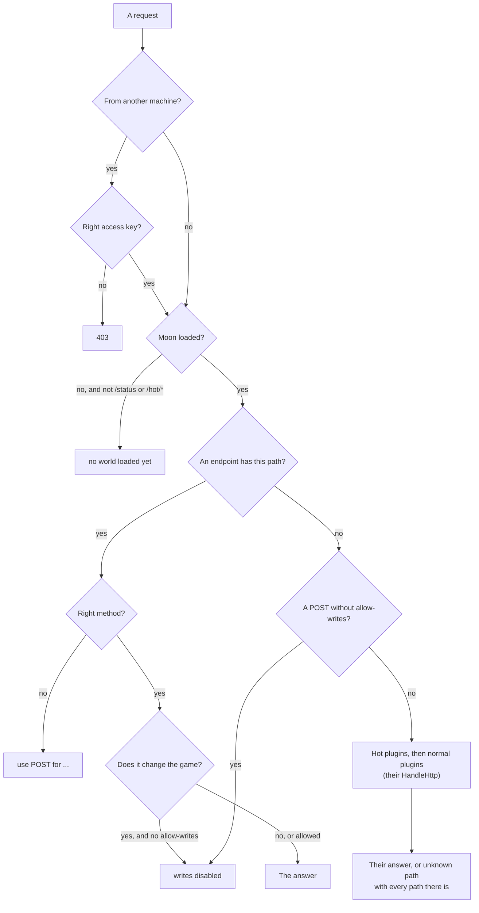

# Using the API

LunarLink answers HTTP on `http://127.0.0.1:8765/` (see [[Settings]] to change that). Every answer is JSON.

## The pattern

| Request | Means |
|---|---|
| `GET /thing` | List it (`GET /structures`, `GET /belts`, `GET /robots`) |
| `POST /thing/check` | Ask the game whether a change would work, without making it (`/structures/check`, `/belts/check`) |
| `POST /thing/create`, `/thing/modify`, `/thing/remove` | Change it |

Reports that don't fit (`GET /production`, `/base/health`, `/terrain`) are `GET`; actions that don't fit (`POST
/message`, `/clean`, `/builder/aim`) are `POST`.

Every request goes through the same checks, in this order:



- **Every change is `POST`** and needs `allow-writes`. A request with the wrong method is refused:
  `{"error":"use POST for /structures/remove"}`.
- **An unknown path** answers with every path there is.
- **Before a moon is loaded**, only LunarLink's own endpoints (`/status`, `/hot/*`) answer; the rest say
  `{"error":"no world loaded yet"}`.

## Examples

```bash
# is it up, and which build
curl -s 127.0.0.1:8765/status

# every structure within 30 m of a point, and only robots
curl -s "127.0.0.1:8765/structures?x=0&y=2000&z=0&r=30"
curl -s "127.0.0.1:8765/structures?kind=99"

# is the base round this point working?
curl -s "127.0.0.1:8765/base/health?x=0&y=2000&z=0&r=150"

# ask the game whether a belt could go here, then build it
curl -s -X POST 127.0.0.1:8765/belts/check  -d '{"start":[...],"startDir":[...],"end":[...],"endDir":[...]}'
curl -s -X POST 127.0.0.1:8765/belts/create -d '{"start":[...],"startDir":[...],"end":[...],"endDir":[...]}'

# remove one structure from anywhere, the game's refund paid
curl -s -X POST "127.0.0.1:8765/structures/remove?ids=41001"
```

From Python:

```python
import json, urllib.request
API = "http://127.0.0.1:8765"
get  = lambda path: json.load(urllib.request.urlopen(API + path))
post = lambda path, body=None: json.load(urllib.request.urlopen(urllib.request.Request(
    API + path, data=json.dumps(body).encode() if body is not None else b"", method="POST")))

print(get("/status"))
print(len(get("/structures")), "structures")
```

## A whole job: build a belt between two points

```bash
API=127.0.0.1:8765
# 1. stand near the place (building needs the player within about 22 m)
curl -s -X POST "$API/player/modify?x=10&y=2001&z=-4"
# 2. ask first: the answer says whether it fits and what's in the way
curl -s -X POST $API/belts/check  -d '{"start":[10,2000,-4],"startDir":[1,0,0],"end":[20,2000,-4],"endDir":[1,0,0]}'
# 3. build it, then look at what's there now
curl -s -X POST $API/belts/create -d '{"start":[10,2000,-4],"startDir":[1,0,0],"end":[20,2000,-4],"endDir":[1,0,0]}'
curl -s "$API/belts?x=15&y=2000&z=-4&r=8"
```

Whole jobs step by step (filming with the observer camera, building, finding why a base stopped, clearing dust,
measuring fps, hosting): [[API Recipes]].

**Or ask an AI assistant:** the [[MCP]] server turns every endpoint into a tool for Claude or any MCP client, so you
can ask "is my base working?" instead of calling `/base/health` yourself.

## Good to know

- **Requests run on the game's main thread**, at most about 8 ms of them a frame. A big request (every structure on a
  large map) is a short hitch; filter it (`/structures?x=&y=&z=&r=`) when you only need part.
- **Removing many structures at once freezes the game**: the game's removal costs about 15 ms when the last one was a
  quarter of a second ago, but 100-130 ms straight after another. Remove one at a time with a gap of about 0.25 s.
- **Building needs the player nearby** (about 22 m): move them first with `POST /player/modify?x=&y=&z=`. Removing
  works from anywhere.
- **The player in a vehicle** ignores teleports.

## From another plugin

A plugin, hot or normal, uses the API the same way: HTTP to `http://127.0.0.1:8765/`. It needs no reference to
LunarLink and no key (it's on this machine); changes still need the `allow-writes` file. **Never wait for the answer
on the game's main thread** (in `Update()`, a Harmony patch, a Unity callback): LunarLink answers on that same thread,
between frames, so a request the main thread waits on can never be answered and the game freezes. Send it from a task
and use the answer later:

```csharp
static readonly System.Net.Http.HttpClient http = new() { BaseAddress = new System.Uri("http://127.0.0.1:8765/") };
static volatile string money;                                  // read on the main thread whenever it's there

static void AskMoney() => System.Threading.Tasks.Task.Run(async () =>
{
    try { money = await http.GetStringAsync("game/money"); }   // {"money":1250000.5}
    catch { money = null; }                                    // LunarLink isn't installed, or not running
});
```

With LunarLink missing the request just fails, so the plugin carries on without it.

## Finding endpoints

- `GET /help` lists every endpoint with what it does, grouped by area and plugin; `/help?path=/structures` narrows it.
- `/help.html` in a browser is the same list as a searchable page.
- [[API Reference]] has LunarLink's own endpoints as tables.
